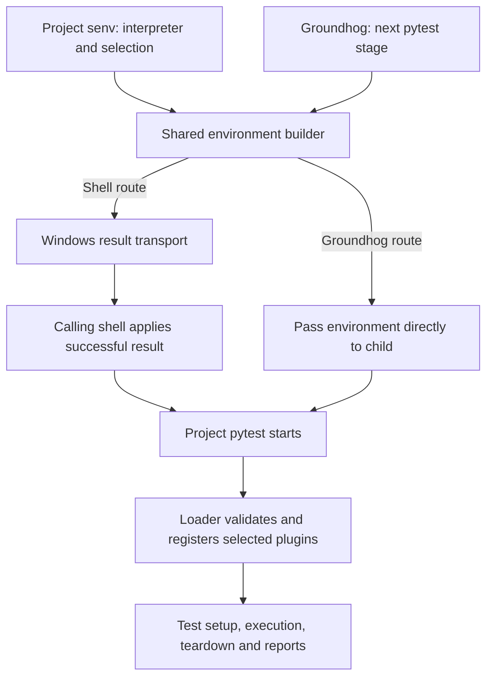

# Design v0.14.0 -- Shared lifecycle gate

Reference feature request:
[Every Suite Gets a Stopwatch](feature-request.v0.14.0.shared_lifecycle_gate.md).

## Context for v0.14.0 shared lifecycle enforcement

The lifecycle budget and process audit currently protect llm-shared's tests
through one suite-local plugin. Consumers run their own interpreters and have
colliding top-level package names, so exposing llm-shared's repository root or
installing its Python 3.13 project is unsuitable. This design separates the
policies and supplies prepared-environment activation without either dependency.

A pytest plugin is a Python module registered with pytest for execution hooks.
The gate receives setup-through-teardown hooks for measurement; the audit
tracks lifecycle and fixture execution for process permissions. A loader is
the startup module that validates the selected checks and registers them in
the consuming project's pytest process. Environment preparation only makes
that later loading possible; it must not import either policy into itself.

The requirement's Q01-Q16 decisions remain authoritative. The design decisions
table records Q01-Q09 confirmed on 2026-11-06 and Q10 confirmed on 2026-11-07.
Independent review converged in round 6 before the user authorized consolidation.
The interfaces below apply those decisions within the requirement's scope.

## Scope for the v0.14.0 shared plugins

The design delivers independently selectable lifecycle and process policies,
one import route for prepared pytest and all groundhog test stages, compatible
checkout records, and recurring executable Python 3.12 verification.

Both policies support Python 3.12 and later and pytest 9.1 and later. Windows,
Python 3.12 and Python 3.13 are the release validation targets. Standard-library
APIs express portable intent; Linux and macOS remain unvalidated in this release.
Future supported versions are not described as already validated.

Persistent adoption or test conversion in consumers, changes to groundhog's
speed verdict, additional shared suite plugins and changes to llm-shared's own
Python requirement remain outside this effort. llm-shared uses both policies
without test or fixture process permissions.

## Design decisions for the v0.14.0 shared lifecycle gate

| Question | Decision and rationale | Integrated in | Rejected alternatives |
| --- | --- | --- | --- |
| Q01 | A1: Dedicated import directory and early loader use the shared checkout without a separate distribution lifecycle, preserving Python 3.12+, unique module names, canonical registration and selected-import exit 4. | [Standalone modules](#standalone-modules-and-canonical-import-identities), [early failure](#early-failure-and-duplicate-loading). | A2: Independent distribution adds build/install and checkout synchronization. |
| Q02 | B1: Shell selection through `LLM_SHARED_PYTEST_PLUGINS`, bound by preparation to `LLM_SHARED_PYTEST_ROOT`, fits `senv` ownership and file-free trials. Preserve unrelated environment entries and reject stale bindings outside preparation. | [Prepared environment](#opt-in-and-prepared-environment-contract). | B2: A repository selection file adds parsing, precedence and root-discovery contracts. |
| Q03 | C1: `LLM_SHARED_PROCESS_FIXTURES` maps decorated fixture objects to non-empty reasons as ordinary Python data, harmless without the audit. Require unambiguous registered definitions and reject conflicting declarations. | [Declaration interfaces](#independent-audit-state-and-declaration-interfaces). | C2: Function attributes expose unwrapping and make misspellings harder to validate. |
| Q04 | D1: A bounded fixture execution/finalization/registry adapter provides one ownership model. Check capabilities at startup, unwind on failure and bind permissions to the live executing thread/token; restore instrumentation after the last session detaches. | [Fixture ownership](#fixture-ownership-and-finalization). | D2: Public setup hooks plus finalizer wrapping multiply interception paths without avoiding all internals. |
| Q05 | E1: Validate each worker's actual declarations before announcing collection, using xdist's all-worker barrier. Require identifying evidence, cancellation handling and controller exit 4 for declaration errors; missing evidence or inconsistent collection prevents scheduling. | [Declaration interfaces](#independent-audit-state-and-declaration-interfaces). | E2: Extra controller collection duplicates imports and may differ from worker definitions. |
| Q06 | F1: A dedicated managed Python 3.12 environment and independent manifest provide repeatable compatibility validation, with a verified absolute-path override. Require explicit setup and real version/dependency checks; missing prerequisites fail without consumer installs. | [Compatibility execution](#process-free-regressions-and-executable-compatibility). | F2: Operator-only provisioning permits dependency drift and is harder to reproduce. |
| Q07 | G1: A tracked own-project declaration requires fresh executable compatibility preflight for every day and direct full invocation, outside audited tests and independently of plugin selection. `check.bat` keeps static/parse checks; consumers gain no separate 3.12 prerequisite. | [Compatibility execution](#process-free-regressions-and-executable-compatibility). | G2: A dedicated whole-suite wrapper changes the complete-validation command and leaves bare full as partial evidence. |
| Q08 | H1: Publish loader-only immutable source-SHA-256 entries in a user-local cache, with environment-carried bindings. Verify existing entries, reject contract mismatches with exit 4, publish no partial activation and require explicit cleanup. | [Early failure](#early-failure-and-duplicate-loading). | H2: A mandatory external cache adds machine configuration without improving the required stale-shell failure contract. |
| Q09 | I1: A plain-pytest root-conftest snippet registers all four lifecycle keys without shared imports, preserving tracked settings in unprepared and audit-only strict runs. The gate retains its defaults and project/`-o` precedence through Q10's guard. | [Settings and proof states](#measurement-limits-and-proof-states), [adoption documentation](#temporary-consumer-trial-and-documentation). | I2: Prepared-only overrides move project settings into shell preparation. I3: Accepting unknown-key warnings breaks strict runs. |
| Q10 | J1: The snippet registers keys only when the canonical gate plugin is absent. Public plugin-manager and `config.getini` APIs preserve gate defaults and override precedence in both loading orders. An outdated unguarded snippet can silently replace defaults; the guard is required documentation. | [Settings and proof states](#measurement-limits-and-proof-states), [adoption documentation](#temporary-consumer-trial-and-documentation), [acceptance cases](#acceptance-cases-for-the-v0140-shared-lifecycle-design). | J2: A private configuration reader adds another pytest compatibility surface. J3: `default=None` registration depends on copying exact defaults. |

## Confirmed technical facts for the v0.14.0 extraction

These facts were checked against the current source before drafting.

| Current source | Confirmed behavior and design consequence |
| --- | --- |
| `tests/simulation_policy.py` | Installs an audit hook at import, tracks active tests through `pytest_runtest_protocol`, and measures CPU from before setup through teardown. Separate plugins must each own their necessary lifecycle state. |
| `tests/lifecycle_cpu_record.py` | Implements the band, proof withdrawal, record schema 1, exception validation, node-ID normalization and controller collector. Its artifact lookup imports two `tools` modules, which cannot remain runtime dependencies. |
| `tools/review_artifact_configuration.py` | Reads a strict optional `[review-artifacts] home` declaration, checks repository containment and resolves the default `.reviews`. The current lifecycle caller substitutes a filesystem ignore check for Git subprocess use. |
| `tests/conftest.py` | Registers `tests.simulation_policy` alongside unrelated suite plugins. Those unrelated plugins retain their current ownership. |
| `pyproject.toml` | Declares Python `>=3.13,<3.14`, coverage source `tools`, fail-under 100, and Python 3.13 type checking. The consumer runtime therefore needs a separate compatibility boundary. |
| `senv.bat` | Adds llm-shared's `bin` to `PYTHONPATH` and creates pytest doskey shortcuts. Neither arrangement makes plain consumer pytest import the existing gate. |
| `tools/groundhog/commands.py` | Resolves the project's `pytest` through `PATH` and supplies spawn-only environment overrides through its runner. Activation belongs in that child environment, without switching interpreters. |
| `check.bat` | Aggregates static checks before the suite. It provides a project-local place to require the separate compatibility validation without adding it to consumer groundhog runs. |

## Current and target flows for prepared test runs

Today, llm-shared's conftest loads the combined suite policy, while consumer
pytest runs have neither policy. Groundhog executes the consumer's pytest;
its own interpreter does not determine the test interpreter.

For a consuming project with its own virtual environment, the target flow is:

1. Its `senv.bat` chooses the project interpreter and declares the safeguards.
2. The shared environment builder normalizes selection, verifies the needed
   source files and loader cache, and computes the environment result. These
   checks read sources; they do not import the policy modules.
3. For shell activation, a Windows transport adapter encodes that successful
   result for the calling batch shell. The launcher applies it only after
   preparation succeeds. Escaping and temporary-output cleanup belong to this
   transfer boundary: a child Python process cannot mutate its parent shell.
4. Ordinary pytest starts with the dedicated directories on `PYTHONPATH` and
   the loader selected through `PYTEST_ADDOPTS`.
5. Inside that pytest process, the loader validates the project binding and
   every selected policy before registering them. Pytest then runs the tests
   with the selected lifecycle hooks and reporting.
6. Groundhog uses the same builder for every pytest stage, passing its result
   directly as the child environment. It bypasses Windows transport and never
   imports the policies into the long-lived groundhog process.



The loader carries no policy. Each selected policy supplies its own startup
validation, runtime hooks and reporting. Unselected policies are not imported.

The builder's result is shared by both routes; the shell adapter only formats
and transfers it. It must not implement a second selection or preparation
algorithm. The implementation plan's Q02=B1 assigns that Windows boundary to
`tools/pytest_plugin_shell.py`, with its own focused tests. A value containing
spaces, percent, exclamation, caret, ampersand or quotes must survive transfer
unchanged; preparation failure must not expose partial new settings.
These follow from preserving unrelated environment entries (Q02) and
publishing no partial activation (Q08); they add no design decision.

## Import and activation boundary for v0.14.0 consumers

### Standalone modules and canonical import identities

Use a dedicated directory under `tools/pytest_plugins/`, exposing only these
top-level module names to the consumer:

| Module | Responsibility |
| --- | --- |
| `llm_shared_lifecycle_gate` | Lifecycle clocks, settings, record model, artifact lookup and CPU-band reporting. |
| `llm_shared_process_audit` | Process events, active lifecycle, permissions, declaration validation and exemption reporting. |
| `llm_shared_pytest_loader` | Prepared-run selection validation, import preflight and idempotent policy registration; preparation materializes this bootstrap independently of the shared checkout. |

Add only the dedicated policy directory and prepared bootstrap directory to
`PYTHONPATH`; do not add llm-shared's repository root or `tools` directory.
The consumer's `tools` and `tests` packages remain
importable. No distribution installation or entry-point auto-discovery is
required. Each policy module imports only stdlib and pytest; neither imports
the other policy, loader, record helper or any other llm-shared module.
The loader imports selected policies by their canonical names.

Keep each module within the repository's file-size policy. Internal classes
separate record handling, measurement and reporting without introducing a
consumer dependency on another llm-shared module.

### Opt-in and prepared-environment contract

Use `LLM_SHARED_PYTEST_PLUGINS`, containing a comma-separated selection of
`lifecycle` and `process`. Empty means neither. Unknown names are configuration
errors; repeated names normalize to one selection. A project's `senv.bat`
declares its selection and invokes a shared preparation launcher after choosing
its own interpreter. No pytest alias is required for activation.

Preparation captures the project root as `LLM_SHARED_PYTEST_ROOT`, exposes the
dedicated directory and the independent bootstrap, and prepends
`-p llm_shared_pytest_loader` to
`PYTEST_ADDOPTS`, preserving existing options and avoiding repeated entries.
The root binds selection to that project. Only preparation, in `senv` or in
groundhog's child environment, refreshes a binding. At pytest startup, before
registration, the bootstrap rejects a run whose pytest `rootpath` lies outside
`LLM_SHARED_PYTEST_ROOT`, with exit code 4 naming the bound root and the
selection; a rootdir inside the project stays accepted. A nested pytest process
for another directory, such as a generated temporary project, clears the
preparation variables first.
Re-preparation recomputes owned entries, so deselection removes activation
without deleting unrelated path entries or pytest options.

Groundhog uses the same normalization and environment-building contract for
every pytest stage, including affected, focused, timings and full runs. It
passes the prepared selection to the project's pytest and its xdist workers.
Its parent environment is not mutated by child preparation. Project switching
cannot silently reuse another project's selection.

Carry the policy directory as `LLM_SHARED_PYTEST_POLICY_DIR` alongside the
project root and selection in the prepared environment. Cached bootstrap code
contains none of these bindings. Separate shells can therefore select different
shared checkouts for the same consumer without changing each other's loader.

Outside the prepared environment, nothing activates automatically. An operator
can expose the dedicated directory and use `-p llm_shared_lifecycle_gate` or
`-p llm_shared_process_audit`. Such explicit loading needs no selection variable.
Selecting neither leaves outcomes, records and both policy summaries unchanged.

### Early failure and duplicate loading

Preparation atomically materializes a self-contained copy of the loader in a
user-local cache outside both the consumer and shared checkout. Each entry is
content-addressed by the SHA-256 hash of the bootstrap source and contains only
the bootstrap module. Publish a new entry atomically once, verify any existing
entry against that hash, and never replace an entry used by a prepared shell.
An existing entry that fails verification stops preparation with a diagnostic
naming the entry and the documented cleanup. Preparation never rewrites it and
publishes no environment.
Changed source gets a new directory. Cleanup is an explicit, documented
operation, never an automatic step of preparation, because no record shows
which entries prepared shells still use. Removing an entry a shell still uses
leaves that shell on the policy directory's source loader, as described below.
This
bootstrap contains no policy and imports no shared helper. Its separate import
directory precedes the shared policy directory, whose loader source must not
shadow it. Preparation checks the bootstrap, the policy directory and every
selected module before exposing the environment. Groundhog repeats these
checks before spawning each selected stage. No package installation is needed.

The prepared bootstrap survives moving or removing the shared checkout. It
checks the bound shared policy path and preflights selected modules there,
without accepting an installed or cached policy as a fallback. A stale prepared
shell therefore still reports the selected policy, selection and exit code 4
if that checkout disappears, including `python -m pytest` and script entry
points. Re-preparation selects the matching immutable entry; a failure does not
publish a partly prepared environment. The cached bootstrap survives removal
of the shared checkout; the policy directory's source loader still serves if
only the cache is removed. Removing both copies removes every executable
bootstrap and leaves pytest's own import error before tests.
Preparation never creates the review artifact home for this cache; a missing
or invalid home still leaves the gate strict and record-free. Cache storage
does not change consumer project files, including during the transient trial.

Define one bootstrap-to-policy contract version, exposed by each standalone
policy and the loader. Preflight checks every selected policy's version before
registration. A stale bootstrap against a changed contract stops before tests
with exit code 4, naming the selection and asking to prepare the shell again.
Missing version declarations are mismatches. Live policy edits remain visible;
no cached policy or contract-mismatched registration substitutes for them.

pytest processes tracked `addopts` before `PYTEST_ADDOPTS`, then command-line
options. The bootstrap is first only among preparation's injected `-p` entries.
The opt-in guide must keep policy `-p` entries out of tracked `addopts`, where
they would import before the bootstrap. During its early import the bootstrap
validates selection and preflights every selected module before later
command-line `-p` options or collection can bypass a selected-policy error.
Convert selected import failures to `pytest.UsageError` naming the canonical
plugin, `LLM_SHARED_PYTEST_PLUGINS` and the project selection. Exit code is 4.
No tests run after partial preflight success.

Register the preflighted modules through pytest's canonical plugin-name
mechanism before initial conftest loading. An already registered canonical
module is reused; explicit loading before or after registration cannot install
a second gate, audit hook dispatcher or collector. Blocking a selected policy
with `-p no:...` is an identifying usage error rather than silent deselection.

The loader and each policy have a Python 3.10-parseable entry path. Check
`sys.version_info` before executing newer APIs or evaluating incompatible
definitions; below 3.12 raise a usage error identifying the module and minimum.
Use Python 3.10-compatible syntax throughout these standalone files to keep
that boundary inspectable. Before refusal, execute only `sys` and `pytest`
imports, the version comparison and the identifying usage-error raise. This
keeps the pre-refusal API boundary inspectable at 3.10 despite Pyright's 3.12
target for supported execution.
Repeatable parsing checks cover the entire entry
path; simulated-version tests exercise refusal. Neither replaces real 3.12
execution. Explicit loading receives the same version guard.

## Lifecycle policy and record continuity in v0.14.0

### Measurement, limits and proof states

The gate starts parent-process CPU measurement before setup and stops after
teardown, retaining the existing report-hook CPU inclusion. Wall time remains
the sum of setup, call and teardown report durations. Shared fixture work is
charged to the lifecycle that performs it. Child CPU and detached-child lifetime
are not measured; starts and waits performed inside a lifecycle remain charged.

Retain the four ini keys and `-o` / project / default precedence:

| Setting | Default | Accepted range |
| --- | --- | --- |
| `test_lifecycle_limit` | 0.1 seconds | Finite and greater than zero. |
| `test_lifecycle_wall_limit` | 1 second | Finite and greater than zero. |
| `test_lifecycle_cpu_band_factor` | 2.5 | Finite and at least 1. |
| `test_lifecycle_cpu_drift_runs` | 3 | Finite whole number at least 1. |

Invalid values name the key and stop startup with exit code 4. Selection applies
enforcement immediately; there is no off value, report-only mode or grace state.

For tracked lifecycle keys to remain usable without the gate, the project's
root `conftest.py` carries a plain-pytest `pytest_addoption` snippet registering
the four keys with `parser.addini`. This imports no shared code. pytest keeps
the last `addini` registration of a key, and a root conftest registers after a
`-p` plugin, so an unguarded snippet replaces the gate's type and default.
The required snippet takes `pytest_addoption(parser, pluginmanager)` and
registers the keys only when
`pluginmanager.has_plugin("llm_shared_lifecycle_gate")` is false. The
gate's own registration then supplies the defaults, and `config.getini` keeps
the `-o`/project/default precedence without deprecated or private pytest
configuration access. An outdated snippet without the guard can silently
replace the gate's defaults; public API cannot detect that copy. Document the
guard as part of the required snippet. Verify both loading orders with absent
keys, tracked values and `-o` overrides, and verify tracked keys with the gate
absent in unprepared and audit-only runs under strict configuration and
warnings-as-errors.

The current per-test ceiling, accepted measured CPU exceptions, eligible proof,
band-top pass and consecutive-drift withdrawal rules remain unchanged. Only a
passing call with no other phase failure contributes a measured observation.
Preserve report properties, failure text, both clocks, ceiling basis and the
documented `lifecycle CPU band` summary. Existing failures are not overwritten
by a second budget failure.

### Artifact-home lookup and persistence

The standalone gate owns a stdlib-only copy of the current lookup contract:
strict `.review-artifacts.ini`, one `[review-artifacts]` section and `home`
property, default `.reviews`, repository-relative spelling and resolved physical
containment. It starts no Git process. A usable home must already exist and
contain `.gitignore` with exactly the currently accepted catch-all bytes.
Invalid, unavailable or unsafe homes retain strict limits, write nothing and
produce the existing no-home summary. The gate never prepares the home.

Retain `a.test-lifecycle-cpu.local.json`, schema 1, node-key normalization and
the `nodes` / `exceptions` objects. Exceptions retain measured `cpu`,
`attempted` and `reason`, with no tracked numeric exception source. Proofs
remain eligible under unchanged current ceilings; lowering a ceiling can
invalidate a proof as it does today. Extraction needs no record migration.

Workers read the same initial policy and attach lifecycle observations to
reports. The controller merges observations and writes once per run; a serial
run performs that responsibility locally. Preserve accepted exception content
and existing valid records, including llm-shared's checkout record. Subsequent
contract changes must document compatibility or migration separately.

## Process permission boundaries for v0.14.0

### Independent audit state and declaration interfaces

The audit independently tracks setup, call and teardown. Its process-lifetime
audit hook observes the existing process-event set and rejects an unpermitted
start with the carrying test and event. Collection, conftest imports during
collection and worker startup stay outside enforcement. The hook dispatches
only to an active session, so embedded pytest sessions cannot retain stale
test identities or permissions after unconfiguration.

Install one audit dispatcher per process, using a process-wide guard that
survives module reload and import under another name. Module-local flags alone
are insufficient. Each session attaches and detaches its own active state.

Use a `process_allowed(reason="...")` pytest marker for named test
functions and individual parametrized cases. Consumers register the marker
independently in normal pytest configuration, including environments without
the audit. Class/module marks and empty or malformed reasons are invalid.

Use a plain module dictionary named `LLM_SHARED_PROCESS_FIXTURES` in a
conftest or collected test module. Keys are the actual decorated fixture objects;
values are non-empty reason strings. For example:

```python
@pytest.fixture(scope="session")
def service():
    ...

LLM_SHARED_PROCESS_FIXTURES = {service: "Exercises the real service protocol"}
```

This is ordinary Python data, requiring no llm-shared import, fixture mark or
pytest ini extension. It remains harmless with no audit, including gate-only
runs, strict configuration, strict markers, pytest strict mode and warnings as
errors. Exporting an imported fixture object in a declaration is allowed when
it resolves to an actual registered fixture definition. Invalid objects,
ambiguous resolution and conflicting reasons are identifying usage errors.

After collection and before any test setup, validate every declaration in
loaded conftests and collected test modules, including unused fixture entries.
Validate test markers and their original declaration level, not only the
effective inherited marker list. Serial and xdist runs both use exit code 4
for invalid declarations, without allowing tests to start on another worker.
Use xdist's existing `collection_is_completed` barrier, which counts the workers
that have announced their collection. Each worker validates in a
`pytest_collection_finish` implementation ordered before xdist's announcement.
After any declaration error, it withholds the announcement, leaves identifying
evidence for the controller and ends with a usage error, so the barrier never
completes. Validation never fails after the announcement: pytest still runs
`pytest_collection_finish` when `pytest_collection_modifyitems` raises, and xdist
then schedules the announced collection on the other workers. The controller
treats a worker that finishes before announcing its collection as a stop, never
as a wait. When that worker's evidence names a declaration error, the controller
stops the remaining workers and exits 4 with the identifying usage error. An
announced collection is the worker's validation evidence. Serial runs validate
at the same point. Cancellation, missing validation evidence or inconsistent
worker collections prevent scheduling; the controller stops rather than waiting
for a worker that cannot announce a validated collection.

### Fixture ownership and finalization

Use a narrow pytest compatibility adapter around fixture execution and
finalization to identify the active fixture definition, scope and own work.
Public setup hooks alone do not delimit every finalizer or identify all loaded
unused fixture declarations. The adapter may inspect pytest's fixture registry;
it must validate the expected capabilities at startup and stop with an
identifying usage error if a future pytest changes them incompatibly.

Nested requested fixtures replace the outer fixture's ownership while their
own setup or finalization runs, then restore it even after errors. Cached
fixture access grants no new permission. Finalization re-enters the finalized
fixture's own ownership, including yield teardown and registered finalizers;
dependency finalization switches to that dependency's owner.

Authorization follows the most specific active work:

| Active work | Applicable permission and usage credit |
| --- | --- |
| Explicitly exempt fixture's own work | That fixture only, irrespective of the consuming test. |
| Unexempt function fixture | The carrying test's permission, if any. |
| Unexempt broader-scoped fixture | None, even when the carrying test is exempt. |
| Test call | The test/case permission, if any. |
| Later background activity | Current lifecycle rules, without inheriting an expired fixture permission. |

Fixture ownership is bound to the thread executing that fixture operation and
its live execution token. A copied context or background thread cannot retain
the fixture's permission. A process start on any other thread is not that
fixture's own work, even while its setup or teardown is running, and is judged
under the active lifecycle. Helpers and pools that start processes on another
thread receive no fixture permission. All ownership stacks unwind on failure.
Install the fixture adapter once per process under the same process-wide guard
as the audit dispatcher. Each session attaches and detaches its own ownership
state. Restore pytest's original fixture callables only when the last attached
session detaches, and only while they still hold the adapter's wrappers.
The existing shared-fixture setup caching and teardown attribution remain
pytest's behavior. Neither kind of permission changes timing enforcement.

### Exercised permissions and xdist aggregation

Track test permissions by normalized node ID. Track fixture permissions by a
stable definition identity containing repository-relative source, qualified
name, declared fixture name, registration scope/base and fixture scope. The
same definition's parameter values and worker instances share one permission
identity; overridden definitions remain distinct.

Only an executed test or entered fixture instance is exercised. Each record
contains identity, reason and a used boolean. A permitted process event credits
exactly one applicable permission. Merge worker records by identity with boolean
OR for use and verify reason consistency. A test can therefore be unused when
all starts were credited to its exempt fixtures.

The controller emits one combined summary with separate test and fixture
groups; serial execution emits it locally. Flag exercised unused permissions
without failing, omit unexercised declarations, and list each fixture definition
once per run. Audit-only runs have this report and no gate settings, CPU-band
report or lifecycle record. No audit means no exemption report. llm-shared's
own suite declares and reports no permissions.

## Compatibility validation boundary for v0.14.0

### Process-free regressions and executable compatibility

Keep the existing gate assertions and add repeatable in-process isolation
coverage for both standalone policies, activation preparation and fixture
ownership. Simulated imports, environment construction and observed runner
dependencies cover integration branches without starting processes inside
llm-shared's suite. All shipped plugin and activation code remains under the
`tools` 100% coverage gate; the extraction adds no coverage omissions.

llm-shared's own prepared shell and groundhog child environments select neither
policy automatically. Its `tests/conftest.py` loads both canonical modules only
after pytest-cov has started coverage. Its tests import them only by canonical
names, never as `tools.pytest_plugins` modules. Early `-p` loading in its own
suite would execute module-level code before coverage and is therefore excluded.
This own-suite path still enables both policies without process permissions.

A separate compatibility harness runs outside that suite. It depends only on
stdlib, pytest and optional pytest-xdist, never llm-shared's Python 3.13 helpers
or root conftest. It exercises actual plugin loading, settings, budget failures,
process rejection and allowed starts, declarations, fixture teardown boundaries,
summaries and selected activation on Python 3.12. It also checks xdist behavior
with the optional dependency present and plugin independence without it.
Generated test projects and records belong to temporary directories.

Use a dedicated Python 3.12 virtual environment provisioned through a
standalone compatibility dependency manifest, outside llm-shared's project
dependency resolution. A machine-local absolute interpreter override may select
an equivalent prepared environment. Validate the executable's real version and
required dependencies; do not select whatever `python` happens to name.
Missing or unsuitable 3.12 is a validation failure, never a skip or automatic
consumer environment modification. Document explicit environment setup before
unattended validation; validation itself never installs prerequisites into a
consumer environment.

Set Ruff's main `per-file-target-version` to `py310` for
`tools/pytest_plugins/**`, preventing routine `ruff check --fix` from applying
the project's inferred Python 3.13 target there. Set a Pyright execution
environment for that directory to Python 3.12. `check.bat` runs static Python
3.12 checks and the Python 3.10 entry-path parse check, without the executable
harness.

Use an own-project whole-suite preflight running the executable harness
for every day walk and every direct `ghog full`, outside the audited test
window. Its applicability comes from an explicit declaration tracked in
llm-shared and read from the project under test, so every clone and linked
worktree of llm-shared runs it. Never derive it from a consumer name, an untracked
machine-local file or plugin selection. Each invocation obtains
fresh executable evidence; no harness-result reuse contract is needed.
The normal Python 3.13 suite and full-speed validation remain
required. Consumer groundhog runs gain no Python 3.12 prerequisite from this
harness. Plain pytest remains a suite run, without claiming completion of the
separate whole-suite validation contract.

### Temporary consumer trial and documentation

Acceptance also needs one real consuming environment trial using transient
shell selection and the supported import directory. Cover plain prepared-shell
pytest and an actual groundhog test stage. Leave project files and persistent
activation unchanged. A Python 3.12 trial may supply both evidence obligations,
but cannot replace recurring standalone regression checks.

Publish only anonymous commands, interpreter/platform versions, selected
policies, outcomes and cleanup evidence. Keep consumer identities, private
absolute paths and raw environment output out of tracked evidence.

Update the existing lifecycle reference and limit-setting guide and add
consumer adoption guidance for each policy. Explain the activation boundary,
exit-4 startup failures, bootstrap refresh and cleanup, tracked-key registration
with its plugin-manager guard, independent marker registration, fixture
dictionary, thread-specific permission ownership and summaries. Explain
pool/helper starts on other threads.
Cover temporary higher limits, gradual
reduction and full runs without selection or early stop to enumerate offenders.
Update `instructions/write-fast-python-tests.md` with the shared enforcement
contract. Present documentation categories in explanation, tutorials, how-to
guides, reference order; preserve each page's existing Diataxis purpose.

## File-based IO cost clarification for the v0.14.0 lifecycle design

Preparation reads the named loader/policy sources, verifies or atomically
publishes a loader-only hash entry, and never scans documentation or creates an
artifact home. Each session/worker loads artifact configuration and its initial
record once; audit checks and measurements use in-memory state. Fixture
validation indexes the collected registry once, and the controller retains one
record write per run. Fresh executable compatibility preflight remains required
for every declared day/full invocation, including saved-proof paths.

## Acceptance cases for the v0.14.0 shared lifecycle design

| Scenario | Expected outcome | Requirement basis |
| --- | --- | --- |
| Neither selected | No new enforcement, records or policy summaries. | Q01, Q11. |
| Gate only beside consumer `tools` and `tests` | Consumer packages import; limits and band work; process starts alone are permitted. | Independent loading and collision isolation. |
| Audit only | Unpermitted starts fail during setup/call/teardown; exemption report only. | Q04, Q05, Q14. |
| Prepared plus explicit selection | One canonical registration and one set of summaries. | Q01. |
| Missing selected module, blocked plugin or unsupported version | Identifying startup usage error, exit 4, before test execution. | Q11, Q15. |
| Shared checkout disappears after preparation | Independent bootstrap names the selected policy and selection, exit 4, including plain pytest and `python -m pytest`; no fallback policy. | Q11, K1. |
| Two shared checkouts prepare the same consumer | Immutable bootstrap entries and environment-carried paths preserve each live shell's original binding. | Supported import route and K1. |
| Live policy contract changes after preparation | Startup exits 4 before registration/tests and asks to prepare the shell again. | Q11, K1. |
| Exempt test triggers unexempt session fixture | Process start is rejected and fixture setup failure is cached normally. | Q12. |
| Exempt fixture requests unexempt fixture | Requested fixture has its own boundary; outer permission is not inherited. | Q12. |
| Exempt fixture and exempt consuming test | Fixture starts credit only the fixture; timing still applies. | Q12, Q14. |
| Invalid unused fixture declaration or module test mark | Pre-execution usage error in serial and xdist. | Q13. |
| Valid declarations with audit absent and strict settings | Normal collection and execution, no unknown config or fixture-mark warning. | Q13. |
| Tracked lifecycle keys with gate absent and strict settings | Root-conftest registration avoids warnings/errors; gate defaults and overrides stay unchanged when loaded. | Prepared opt-in and existing settings. |
| Exempt fixture starts work on another thread during setup | No fixture permission crosses threads; active lifecycle decides authorization. | Q12 ownership. |
| Fixture runs on multiple workers or for several parameters | One fixture summary entry; used if any own instance used permission. | Q14. |
| No safe pre-existing artifact home | Strict gate, no writes, explicit no-home summary. | Q06, Q09. |
| Existing valid checkout record | Exception meaning and eligible proofs survive; one controller write. | Q06, Q09. |
| llm-shared whole-suite validation without Python 3.12 | Validation fails before claiming compatibility success. | Q02, Q16. |
| Consumer validation without a separate Python 3.12 installation | No new interpreter prerequisite for that consumer. | Q16. |
| Anonymous real-environment trial | Both activation contexts evidenced, no project-file changes or persistent opt-in. | Q08. |
| One xdist worker finds an invalid declaration, the others are valid | No test starts on any worker; the controller exits 4 naming the declaration, stops the remaining workers and does not wait indefinitely. | Q13. |
| Embedded session loads and unconfigures the audit inside an audited run | The outer session keeps one dispatcher, its fixture ownership and its permissions. | Q12. |
| Prepared shell runs pytest with a rootpath outside the bound root | Exit 4 naming the bound root and the selection, before registration. | Q01, Q11. |
| Gate loaded with the documented key snippet, in either loading order | Gate defaults, tracked values and `-o` overrides keep their precedence. | Q07, Q10. |
