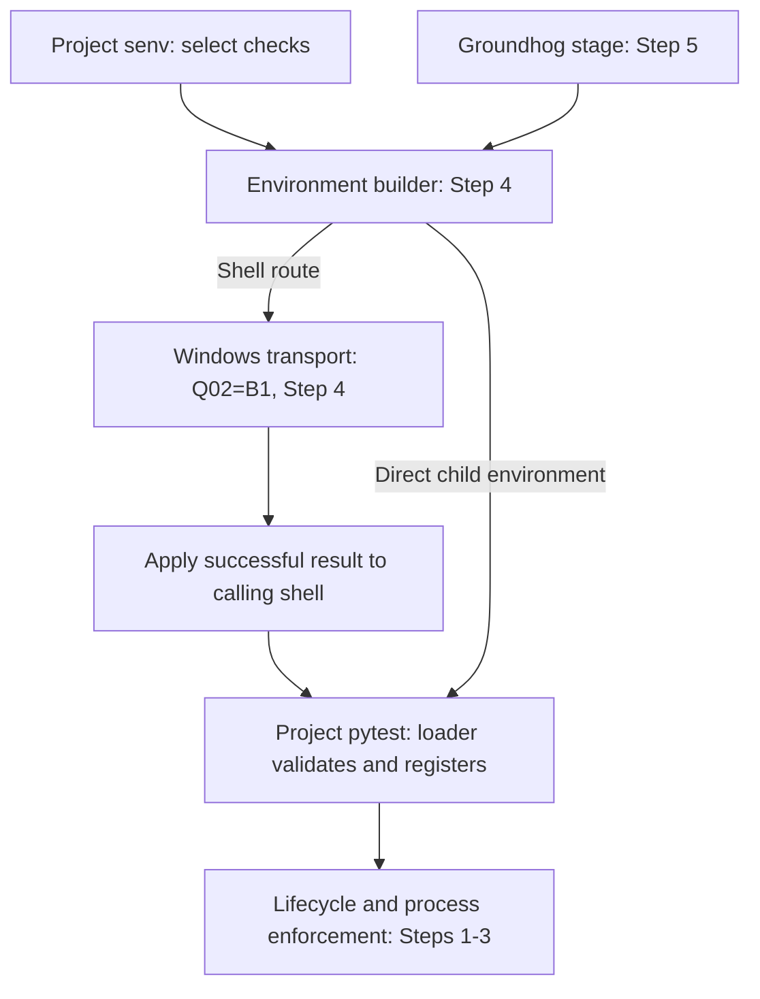

# v0.14.0 shared lifecycle gate implementation plan

Extract the settled policies, connect prepared environments, and validate the
consumer boundary without changing the approved enforcement contracts.

## The pytest plugin mechanism this plan implements

This feature shares llm-shared's existing lifecycle timer and process audit
with consuming projects. A pytest plugin is a Python module registered to
receive execution hooks: the timer measures setup through teardown, and the
audit uses lifecycle and fixture boundaries to enforce process permissions.
The plugins run in the consumer's pytest interpreter; llm-shared is not
installed as a package into that environment. Implementation has not started.

For an ordinary project, the runtime sequence is:

1. Its `senv.bat` chooses the project Python and declares the selected checks.
2. `tools/pytest_plugin_environment.py` computes the prepared environment and
   verifies source/cache inputs without importing the policies.
3. `tools/pytest_plugin_shell.py` transfers that complete successful result to
   the calling Windows shell through `bin/prepare_pytest_plugins.bat`. The
   child computation cannot directly change its parent's environment.
4. The user starts pytest normally. The prepared paths and startup options
   make the loader available; inside pytest it validates selection and
   registers the chosen checks before tests.
5. Test setup, execution and teardown run under those checks and produce the
   required reports and eligible per-checkout record.
6. Groundhog uses the same builder before every pytest stage and passes its
   result directly to the child's environment, bypassing shell serialization.



Step 4 owns preparation, Windows transport and the loader; Step 5 connects
groundhog. The plugins themselves come from Steps 1-3. Steps 6-7 provide
compatibility evidence, acceptance and adoption documentation. The
[design walkthrough](design.v0.14.0.shared_lifecycle_gate.md#current-and-target-flows-for-prepared-test-runs)
explains the component boundaries and loader cache in more detail.

## Plan goal and scope for the v0.14.0 shared plugins

Implement the [requirement](feature-request.v0.14.0.shared_lifecycle_gate.md)
and [settled design](design.v0.14.0.shared_lifecycle_gate.md). Their decisions
remain authoritative. This plan assigns implementation files and verification
work; it does not change policy, defaults, activation scope or permission rules.

1. Extract the standalone lifecycle gate and preserve its record contracts.
2. Implement independent process auditing and fixture ownership.
3. Complete distributed validation/reporting and migrate llm-shared's suite.
4. Implement immutable bootstrap preparation and early plugin loading.
5. Prepare every groundhog pytest child through the same activation contract.
6. Add recurring executable Python 3.12 compatibility preflight.
7. Complete acceptance evidence, anonymous consumer trial and documentation.

Persistent consumer adoption, speed-verdict changes, additional shared plugins,
Linux/macOS acceptance, and changes to llm-shared's Python requirement remain
outside scope. Implementation begins only after the plan's review gates.

## Confirmed code and test facts at eda8f5e

The source and test trees were inspected on 2026-11-07. The current combined
policy has 136 physical lines and imports a 524-line record helper. Combining
them verbatim already reaches 660 lines before standalone lookup and guards.
Step 1 must consolidate repeated scaffolding and relocate process ownership;
it cannot append the two files unchanged. The standalone-policy design forbids
solving this by adding a runtime shared-helper dependency.

`tests/conftest.py` loads the existing combined policy. Only the two lifecycle
test modules import it or the record helper directly. They assert synthetic
CPU samples and real report behavior; preserve every assertion when changing
imports. Other suite plugins stay in place. No current test/fixture process
permission is to be added to llm-shared's suite.

`commands._child_environment` currently combines coverage and worker overrides;
`selection._collect` constructs another pytest child without those overrides.
Both need shared preparation. The day walk can return a saved-proof no-op
before checks, so compatibility preflight must precede that return. Direct
full also needs preflight; a full stage inside a day must not run it twice.

The project environment sets `PYTHON_BIG_FILE_LINE_LIMIT=650`. The big-file
gate counts physical lines including blanks, using iteration over UTF-8 text.
The generic check's fallback is 700; this plan uses the project's 650 ceiling.
No existing file selected below is above 650. `commands.py` is in the risk
band at 633; the inspected CLI is also in that band at 553, but this plan
places new orchestration in focused modules; the CLI gains only Step 5's
binding-check call.

### Existing Python baselines for the planned changes

| File | Physical lines | Policy band | Owning step |
| --- | --- | --- | --- |
| `tests/simulation_policy.py` | 136 | Safe below 550; remove after migration | 3 |
| `tests/lifecycle_cpu_record.py` | 524 | Safe below 550; remove after migration | 3 |
| `tests/conftest.py` | 99 | Safe below 550 | 3 |
| `tests/unit/tools/test_lifecycle_policy.py` | 112 | Safe below 550 | 1 |
| `tests/unit/tools/test_lifecycle_cpu_band.py` | 364 | Safe below 550 | 1 |
| `tools/groundhog/cli.py` | 553 | At risk, 550 through 650 | 5 |
| `tools/groundhog/commands.py` | 633 | At risk, 550 through 650 | 5, 6 |
| `tools/groundhog/runner.py` | 428 | Safe below 550 | 5 |
| `tools/groundhog/day.py` | 423 | Safe below 550 | 6 |
| `tools/groundhog/context.py` | 136 | Safe below 550 | 5, 6 |
| `tools/groundhog/selection.py` | 76 | Safe below 550 | 5 |
| `tests/unit/tools/test_groundhog_commands.py` | 534 | Safe below 550 | 5, 6 |
| `tests/unit/tools/test_groundhog_runner.py` | 478 | Safe below 550 | 5 |
| `tests/unit/tools/test_groundhog_selection.py` | 137 | Safe below 550 | 5 |
| `tests/unit/tools/test_groundhog_cli.py` | 536 | Safe below 550 | 5 |
| `tests/unit/tools/test_groundhog_acceptance_day.py` | 310 | Safe below 550 | 5, 6 |

The `tools/__init__.py` (127), `tools/groundhog/__init__.py` (73),
`tests/__init__.py` (7), `tests/unit/__init__.py` (6),
`tests/unit/tools/__init__.py` (6) and `tests/acceptance/__init__.py` (4)
already establish their packages. Inspect them at execution; no export change
is needed merely to add a leaf. Add the new package markers listed per step.

### Configuration and documentation baselines

| Existing file | Physical lines | Planned use |
| --- | --- | --- |
| `pyproject.toml` | 276 | Canonical module discovery, static targets and own-project preflight declaration |
| `senv.bat` | 340 | Read-only verification of absent automatic policy selection; no edit needed |
| `check.bat` | 235 | Static compatibility and entry-path parsing only |
| `wiki/README.md` | 267 | Adoption and compatibility guide navigation |
| `wiki/reference/test-lifecycle-limits.md` | 156 | Shared gate and record reference |
| `wiki/reference/ghog-commands-and-exit-codes.md` | 297 | Own-project preflight behavior and existing exit semantics |
| `wiki/how-to/set-test-lifecycle-limits.md` | 89 | Guarded key registration and adoption limits |
| `wiki/how-to/register-groundhog-in-a-project.md` | 74 | Shared preparation entrypoint |
| `wiki/explanation/why-fast-tests-keep-the-work-they-assert.md` | 184 | Shared enforcement and unchanged lifecycle attribution |
| `instructions/write-fast-python-tests.md` | 129 | Enforcement boundary and opt-in links |
| `docs/v0.14.0/draft.v0.14.0.shared_lifecycle_gate.md` | 85 | Pytest plugin introduction added during planning |
| `docs/v0.14.0/feature-request.v0.14.0.shared_lifecycle_gate.md` | 408 | IO clarification and pytest plugin introduction added during planning |
| `docs/v0.14.0/design.v0.14.0.shared_lifecycle_gate.md` | 515 | IO clarification and pytest plugin introduction added during planning |

All proposed new paths below were absent at planning. Their baseline is zero;
classify new Python files below 550 initially, with the same 650-line ceiling.
The two plans are new planning deliverables, not implementation evidence.

## File-based IO cost clarification for v0.14.0 implementation

Follow the design's fixed inputs rather than scanning documentation or the
repository during plugin startup. Resolve selection from environment values;
read only the named loader/policy sources needed for preflight. Preparation
verifies or atomically publishes one loader cache entry. It never creates an
artifact home, caches policy code, or automatically cleans live loader entries.

Load artifact configuration and the lifecycle record once per session/worker;
retain observations in memory and perform the existing single controller write
per run. Audit authorization uses active in-memory state; fixture validation
traverses the collected module/fixture registry once per collection. No file
read, directory scan or process start belongs in a per-event audit check.

The compatibility declaration is a named project input, not a repository-wide
search. Every required day/full invocation still obtains fresh executable
compatibility evidence; reducing IO must not reuse an old harness outcome.

## Complexity and timing boundaries for the extraction

Keep clock accounting, permission lookup and usage credit constant-time per
event. Record loading and report merging are linear in entries/observations;
declaration validation is linear in declarations plus registered definitions,
using an indexed lookup rather than rescanning definitions for each entry.
Retain deterministic summary ordering where it exists; sorting once for final
rendering is acceptable and does not belong in the per-event path.

No Step 0 with timeout-marked xfails is needed: this effort adds no new numeric
latency requirement, and existing lifecycle clocks already constrain the suite.
Use fake clocks, counted reads/writes and explicit worker outcomes for unit
checks. Keep process-starting and worker termination checks in the separate
executable harness, where waits must have bounded cleanup. No xfail may stand
in for a completed acceptance obligation.

## Shared execution command checklist for each lifecycle step

Before implementing a step, start/resume its private journal through the
step-journal workflow. Record baseline counts, the selected groundhog command,
outcomes, elapsed time, relevant evidence and remaining work in that journal.

1. Resample the physical line count of every step file before and after edits.
   In PowerShell, use `$stepFiles | ForEach-Object { if (Test-Path -LiteralPath $_) { '{0}: {1}' -f $_, [IO.File]::ReadAllLines((Join-Path (Get-Location).Path $_)).Length } }`,
   after assigning the step's explicit relative paths to `$stepFiles`.
2. Add the step's tests first. Preserve original assertions and use synthetic
   clocks and observed dependencies. Read the fast-Python-tests instruction
   before writing tests. Never launch a process from the audited own suite.
   For in-process pytest sessions use the shared `inline_session.py` helper:
   explicit plugins, `-p no:cacheprovider`, `PYTEST_DISABLE_PLUGIN_AUTOLOAD=1`, and
   `PYTEST_ADDOPTS` plus `LLM_SHARED_PYTEST_*` cleared through monkeypatch.
   Generate one small project per lifecycle; keep policy registration isolated
   from the carrying session. The inner session loads no pytest-cov, so the
   carrying session's coverage still measures the policy code it runs. The reviewer measured
   0.125 to 0.156 s CPU for a warm one-test session with autoload versus 0.016
   to 0.031 s without; those observations motivate isolation, not a new limit.
3. Run focused tests through the canonical full-path `bin/ghog.bat single`
   launcher with the step's actual test paths. Groundhog owns pytest and checks.
4. Run each step's `rg` checks and inspect matches. A deliberate negative
   search exits 1 on no matches; do not confuse that with tool failure.
5. Resolve the ready-to-run walk using the shared full-path
   `bin/prompt_workflow.bat scope day` launcher, following
   [run-pw](../../instructions/run-pw.md). Run its printed command through the
   canonical groundhog launcher, then follow its repair/restart lines until
   the requested objective reports exit 0. Never freeze a group selector.
6. The default day runs checks plus affected tests and deliberately skips full.
   For final acceptance resolve `scope day --full=speed` instead, then run the
   printed command. Its whole-suite result must include fresh coverage and
   timing evidence; an affected-only pass does not meet final acceptance.
7. Resample counts and enforce the 650-line Python ceiling. Advisory estimates
   are planning aids only; exceeding one below 651 does not make a step
   incomplete. No tighter shrink target is imposed by this plan.
8. Review the implementation against the matching validation-plan section.
   Keep executable compatibility and real-trial evidence separate from unit
   coverage. Do not mark an unrun platform or interpreter as validated.

Resolve `<LLM_SHARED_DIR>` from the canonical instruction path, as
[run_commands](../../rules/run_commands.md) requires. Calls use that resolved
absolute path, without environment wrappers or aliases. These are execution
instructions for later steps; writing the plans does not run the test walk.

For Steps 5 to 7, self-hosted validation must run the groundhog of the checkout
being implemented. Resolve that checkout's `bin/ghog.bat` to its absolute path
and invoke it directly. In a linked worktree, its `senv.bat` sets
`LLM_SHARED_DIR` to the worktree; a main-checkout launcher lacks these changes.
Keep canonical workflow/question/review launchers resolved from instructions;
the self-hosted groundhog exception does not change their command boundary.

## Step 1. Extract the standalone lifecycle policy and record model

### Step 1 analysis and intent for lifecycle continuity

The gate currently depends on suite packages and shared artifact helpers.
Create `llm_shared_lifecycle_gate` with only stdlib/pytest imports, retaining
measurement, configuration, proof and persistence behavior. Design anchors:
standalone modules, lifecycle policy and record continuity. Reuse the shared
execution checklist. Consolidation removes duplicated scaffolding; process
state moves to Step 2. Original test outcomes and messages remain the oracle.
Set the standalone static targets before adding the first policy: otherwise
`check.bat` applies inferred py313 rules and reports UP040/UP046 on compatible
typing forms, whose suggested fixes would introduce Python 3.12-only syntax.

### Step 1 implementation files and tests

- `tools/pytest_plugins/__init__.py` (new, to be created): package marker for
  tooling inventory only; consumers import the standalone canonical module.
- `tools/pytest_plugins/llm_shared_lifecycle_gate.py` (new, to be created).
- `pyproject.toml` (existing, to be updated): expose only the dedicated module
  directory for own-suite canonical imports and type-check discovery; keep
  coverage source `tools` and do not omit plugin files. Set Ruff's
  `per-file-target-version` to `py310` for `tools/pytest_plugins/**` and a
  Pyright Python 3.12 execution environment there before the first file exists.
- `tests/unit/tools/test_lifecycle_policy.py` (existing, to be updated).
- `tests/unit/tools/test_lifecycle_cpu_band.py` (existing, to be updated).
- `tests/unit/tools/shared_lifecycle/__init__.py` (new, to be created).
- `tests/unit/tools/shared_lifecycle/inline_session.py` (new, to be created):
  the shared isolated in-process session helper from the execution checklist.
- `tests/unit/tools/shared_lifecycle/test_gate_contract/__init__.py` (new, to be created).
- `tests/unit/tools/shared_lifecycle/test_gate_contract/test_gate_contract_tdd.py` (new, to be created).
- `tests/unit/tools/shared_lifecycle/test_gate_contract/test_gate_contract_pbt.py` (new, to be created).

Tests first: retain the existing clock, report, proof, exception and collector
assertions while redirecting imports to the canonical module. Cover strict
artifact parsing, path/symlink escape, unreadable/invalid homes, exact ignore
bytes, read/write failure, existing valid record round-trip and current-ceiling
eligibility. Test default/project/`-o` precedence, invalid finite/range inputs,
and the guarded root-conftest snippet in both registration orders. Add bounded
property checks for proof/drift transitions and record-key/serialization
invariants; Hypothesis remains a suite-only dependency.

Move `NodeState`, `Record`, `LifecycleGate`, `BandCollector`, measurement hooks
and the minimum artifact lookup into one standalone module. Keep report
properties, original failure text, wall aggregation, report-hook CPU inclusion,
schema 1 and single controller write. Place the Python-version guard before
anything beyond the approved pre-refusal imports and expose the design's
loader-to-policy contract version. The old combined plugin remains the suite's
enforcer until Step 3; merely importing the new gate for tests must not register
a second collector. No record migration or checkout-record deletion is allowed.
Declare the contract version as a module-level integer literal for Step 4's
source-only preparation checks; keep that declaration after the version guard.

Completion: focused old and new tests pass; `rg -n '^(from|import) ' tools/pytest_plugins/llm_shared_lifecycle_gate.py`
shows only allowed dependencies; the resolved day objective passes. Existing
record evidence must distinguish synthetic continuity tests from the final
real-checkout continuity check in Step 7.

### Step 1 addendums and readiness

- [ ] Line budget: new gate baseline 0, safe; ceiling 650. Existing tests
  baseline 112/364, safe; ceiling 650. New tests/markers baseline 0, safe;
  ceiling 650. `pyproject.toml` baseline 276, not a Python gate target.
- [ ] Consolidate record parsing/rendering duplication and move audit hooks
  out before combining existing sources. If the gate exceeds 650, stop and
  reduce repeated internal responsibilities without adding shared runtime
  imports; do not weaken retained assertions or raise the ceiling.
- [ ] Timing readiness: focused old/new gate tests, then the resolved day;
  no executable harness exists yet. Follow the shared checklist.
- [ ] Time-gated status: existing lifecycle limits apply; no new timeout/xfail.

## Step 2. Implement independent audit sessions and fixture ownership

### Step 2 analysis and intent for process permissions

The combined audit has only an active-test list. Implement the settled session,
declaration and fixture ownership model independently of the gate. Design
anchors: independent audit state, declaration interfaces and fixture ownership.
Use the shared execution checklist. Preserve the existing event set/window;
new consumer permissions never become permissions in llm-shared's own tests.

### Step 2 implementation files and tests

- `tools/pytest_plugins/llm_shared_process_audit.py` (new, to be created).
- `tests/unit/tools/shared_lifecycle/test_audit_ownership/__init__.py` (new, to be created).
- `tests/unit/tools/shared_lifecycle/test_audit_ownership/test_audit_ownership_tdd.py` (new, to be created).
- `tests/unit/tools/shared_lifecycle/test_audit_declarations/__init__.py` (new, to be created).
- `tests/unit/tools/shared_lifecycle/test_audit_declarations/test_audit_declarations_tdd.py` (new, to be created).

Tests first: simulate audit events without creating processes. Exercise setup,
call, teardown and inactive collection/startup; nested pytest sessions, reload
and alias import; invalid class/module marks, missing reasons and parametrized
case marks. Validate unused fixture entries, decorated-object identity,
imported fixtures, ambiguous registry matches and reason conflicts. Use real
in-process pytest fixture definitions for adapter capability checks and observe
execution/finalization boundaries without subprocesses.

The process-wide guarded dispatcher attaches session state and survives module
reload/aliases. The bounded fixture adapter checks capabilities at startup,
wraps execution/finalization once, restores only its own wrappers after the last
detach, and unwinds after setup, yield teardown and finalizer failures. Bind
fixture ownership to the executing thread and live token; requested fixtures
replace and restore ownership. No copied context, cached fixture access or
background thread inherits the fixture permission. Test precedence and credit
for exempt fixtures, unexempt function fixtures, broader scopes and test calls.
Exercise nested-session detach while an outer audit remains active.

The audit imports only stdlib and pytest, has the same early version/contract
guards, and owns no lifecycle settings, records or CPU-band collector. Small
deterministic ownership matrices cover this step; a separate property suite is
not needed for these finite boundaries.
Declare the contract version as a module-level integer literal for source-only
preparation checks, after the early version guard.

Completion: rejection names the carrying test/event, capability/declaration
failures are identifying usage errors, and own-session state restores after
every failure. `rg -n '^(from|import) ' tools/pytest_plugins/llm_shared_process_audit.py`
confirms dependency isolation. Focused tests and resolved day pass.

### Step 2 addendums and readiness

- [ ] Line budget: all listed files baseline 0, safe; each Python ceiling 650.
  Group internal audit state, declaration indexing and adapter ownership into
  focused classes in the standalone file. Split tests by declaration versus
  execution responsibility, as listed, before either would exceed 650.
- [ ] Keep the production file within 650 without a helper-module dependency;
  if that cannot preserve the settled model, report the concrete conflict for
  plan/design review before changing architecture.
- [ ] Timing readiness: focused audit tests and resolved day; Step 3 proves
  the real worker barrier before migration. Full process/compatibility
  scenarios remain Step 6 harness obligations.
- [ ] Time-gated status: deterministic token/thread evidence; no new xfail.

## Step 3. Complete worker validation, reporting and own-suite migration

### Step 3 analysis and intent for distributed enforcement

Invalid declarations must prevent all scheduling, and permission reports must
aggregate once. Complete those hooks before replacing the own-suite enforcer.
Design anchors: declaration barrier, exercised permissions and coverage startup.
Follow the shared execution checklist. Preserve pytest's fixture failure
caching/attribution and all unrelated suite plugins.

### Step 3 implementation files and tests

- `tools/pytest_plugins/llm_shared_process_audit.py` (existing after Step 2, to be updated).
- `tests/conftest.py` (existing, to be updated).
- `pyproject.toml` (existing, to be updated): replace obsolete source comments
  and set Ruff/Pyright Python 3.12 targets for the new minimal harness files.
- `tests/simulation_policy.py` (existing, to be removed after migration).
- `tests/lifecycle_cpu_record.py` (existing, to be removed after migration).
- `tests/unit/tools/shared_lifecycle/test_audit_workers/__init__.py` (new, to be created).
- `tests/unit/tools/shared_lifecycle/test_audit_workers/test_audit_workers_tdd.py` (new, to be created).
- `tools/lifecycle_compatibility/__init__.py` (new, to be created).
- `tools/lifecycle_compatibility/runner.py` (new, to be created): minimal
  Python 3.13 executable barrier-smoke runner with bounded child cleanup.
- `tools/lifecycle_compatibility/scenarios.py` (new, to be created): temporary
  xdist project with invalid-worker and valid-peer evidence.
- `tests/unit/tools/shared_lifecycle/test_compatibility/__init__.py` (new, to be created).
- `tests/unit/tools/shared_lifecycle/test_compatibility/test_compatibility_tdd.py` (new, to be created):
  process-free coverage of runner/scenario construction and cleanup branches.

Tests first: model the actual xdist announcement ordering and all-worker
barrier, including one invalid worker with valid peers, early worker exit,
cancellation, absent evidence and inconsistent collection. Assert no scheduling
and bounded controller termination, identifying declaration evidence and
controller exit 4. Validate before xdist announces collection in
`pytest_collection_finish`; do not rely on a modifyitems exception.

For Q01=A3, before replacing the own-suite enforcer, run the minimal executable
barrier smoke outside the audited suite with the existing real Python 3.13
environment and its pinned pytest/xdist. Exercise actual worker announcement
ordering, an invalid worker alongside valid peers, no test starts on peers,
controller exit 4 and bounded cancellation/child cleanup. Generate isolated
temporary projects without root conftest or inherited prepared bindings.
Step 3 owns the runner/scenario and their package markers; process-free tests
observe process boundaries while retaining real scenario construction and
result interpretation under the 100% tools coverage gate. Record actual
interpreter/pytest/xdist versions, outcomes and cleanup before migration.
Do not infer executable evidence from modeled hook tests or grant own-suite
process permissions. Step 6 extends these same files for independent Python
3.12 validation; its manifest, environment provisioning and recurring preflight
remain in Step 6. The early smoke makes no Python 3.12 compatibility claim.

Track stable fixture-definition identities separately from normalized test
node IDs. Merge worker records by identity with boolean OR and consistent
reasons; report exercised tests and fixtures separately, one entry per fixture
definition, including unused permission warnings without failure. Exclude
unexercised work and keep audit-only runs free of gate state/output.

Load both canonical policies through own-suite conftest after pytest-cov starts,
never via own-suite early `-p` activation. Expose their dedicated directory
through Step 1's pytest configuration. Read-only verification of `senv.bat`
confirms neither policy is selected automatically; no shell edit is needed.
Remove both legacy policy files only once existing assertions run against the
shared code.
Own-suite production declarations remain empty; synthetic permission data in
unit tests must not grant the outer session exemptions.

Before the first whole-suite execution with the replacement gate, retain a
private read-only snapshot of the current checkout record in the artifact home.
Compare exception meaning and eligible proofs after that run under current
ceilings, allowing normal measured-run drift updates. Preserve the snapshot
and comparison for Step 7; never restore it over the live record or publish raw
local exception/path data.

Completion: `rg -n 'tests[./](simulation_policy|lifecycle_cpu_record)|from tests import (simulation_policy|lifecycle_cpu_record)' tests tools pyproject.toml`
has no executable references. Both plugins and minimal harness code are
covered under `tools`; no new coverage omit is present. Real Python 3.13
barrier-smoke evidence precedes migration; focused tests and resolved day pass.
The negative check `rg -n 'tools\.pytest_plugins' tests tools` finds no policy
imports under package-qualified aliases; inspect any non-import matches.

### Step 3 addendums and readiness

- [ ] Line budget: audit uses Step 2's measured exit count, ceiling 650;
  conftest baseline 99, safe, ceiling 650; new worker tests/marker baseline 0,
  safe, ceiling 650. New harness/compatibility tests and package markers also
  start at 0, safe, with the same 650-line ceiling.
  Removed sources start at 136/524. Non-Python baselines:
  pyproject 276, resampled after earlier steps; senv 340 is read-only evidence.
- [ ] Keep worker/report methods focused within the standalone audit; move
  shared test builders into this test package only if necessary for the
  ceiling. No standalone-policy helper dependency is authorized.
- [ ] Timing readiness: focused serial/distributed-hook and harness tests,
  executable Python 3.13 xdist barrier smoke before migration, then resolved
  day. Extend the same harness for real Python 3.12 in Step 6.
- [ ] Time-gated status: cancellation tests use explicit fake events; harness
  smoke cleanup already bounds hangs before migration. No xfails remain as
  completion evidence.

## Step 4. Build atomic preparation and the independent early loader

### Step 4 analysis and intent for prepared environments

Implement the approved selection/root binding and immutable source-hash cache.
The loader must survive a moved shared checkout and preflight every selection
before any canonical registration. Design anchors: import/activation boundary
and early failure. Use the shared checklist. Preserve unrelated path/options
and keep unprepared/deselected projects unchanged.

### Step 4 implementation files and tests

- `tools/pytest_plugins/llm_shared_pytest_loader.py` (new, to be created).
- `tools/pytest_plugin_environment.py` (new, to be created): normalization,
  owned-entry recomputation, cache verification/publication and environment result.
- `tools/pytest_plugin_shell.py` (new, to be created): Windows result
  serialization, escaping and temporary-output cleanup; consumes the builder
  result without duplicating environment preparation or selection (Q02=B1).
- `bin/prepare_pytest_plugins.bat` (new, to be created): apply a successful
  environment result to the calling prepared shell; publish nothing on failure.
- `tests/unit/tools/shared_lifecycle/test_preparation/__init__.py` (new, to be created).
- `tests/unit/tools/shared_lifecycle/test_preparation/test_preparation_tdd.py` (new, to be created).
- `tests/unit/tools/shared_lifecycle/test_preparation/test_preparation_pbt.py` (new, to be created).
- `tests/unit/tools/shared_lifecycle/test_shell_transport/__init__.py` (new, to be created).
- `tests/unit/tools/shared_lifecycle/test_shell_transport/test_shell_transport_tdd.py` (new, to be created).
- `tests/unit/tools/shared_lifecycle/test_loader/__init__.py` (new, to be created).
- `tests/unit/tools/shared_lifecycle/test_loader/test_loader_tdd.py` (new, to be created).

Tests first: selection normalization/deduplication, unknown tokens, empty
selection, preservation and removal of owned environment entries, and
idempotent re-preparation. Property checks cover normalization/idempotence
without introducing a consumer Hypothesis requirement. Simulate cache races,
corruption and interrupted publication; two prepared shells retain independent
checkout bindings, including when only cache or only checkout disappears.

For Q02=B1, focused process-free transport tests observe the complete-result
protocol, spaces and percent/exclamation/caret/ampersand/quote preservation,
failure before application and cleanup of transfer-owned temporary output.
The calling shell's delayed-expansion state changes how an applied `set`
line reads its value: with it on, `!` and `^` are consumed. Make the transfer
independent of that state or detect it, and cover both states in the focused
tests. Keep actual calling-shell execution, with delayed expansion off and
on, in Step 7's existing acceptance harness.

Carry `LLM_SHARED_PYTEST_PLUGINS`, `LLM_SHARED_PYTEST_ROOT` and
`LLM_SHARED_PYTEST_POLICY_DIR` exactly as designed. Hash/cache only the loader;
verify existing immutable entries and reject corruption without rewriting.
Preparation and groundhog's per-stage checks verify selected policy file
presence and read the module-level literal contract constant with AST parsing.
They never import policies into the preparing process: an audit dispatcher
installed in groundhog would persist for its lifetime. Actual import preflight
occurs only in the bootstrap inside the project's pytest interpreter.
Ensure bootstrap precedence over the policy directory, with no shared root or
`tools` exposure and no artifact-home preparation. The shell adapter calls the
same environment builder that groundhog will use; keep Windows escaping in
that adapter and test spaces/metacharacters through observed launcher inputs.

The loader guards Python before incompatible work, checks every selected
module and contract before registration, rejects blocked selected plugins,
and registers/reuses canonical identities before initial conftests. Startup
failures name plugin, selection and the selecting opt-in, exit 4. Root binding
validation accepts contained rootdirs and rejects outside roots. Explicit
loading remains independent and duplicate-safe; unselected policies stay
unimported. Do not use installed/cached policies as a stale-checkout fallback.

Completion: in-process import isolation preserves consumer `tools`/`tests`,
missing selected modules cannot reach test execution, and no partial
environment escapes preparation failure. `rg -n 'LLM_SHARED_PYTEST_|PYTEST_ADDOPTS|PYTHONPATH' tools/pytest_plugin_environment.py tools/pytest_plugin_shell.py tools/pytest_plugins/llm_shared_pytest_loader.py bin/prepare_pytest_plugins.bat`
matches only the approved contract. Focused tests and resolved day pass.

### Step 4 addendums and readiness

- [ ] Line budget: all new Python files/markers start at 0, safe; ceiling 650.
  This includes `pytest_plugin_shell.py`, `test_shell_transport/__init__.py`
  and `test_shell_transport_tdd.py` added by Q02=B1.
  Keep shell preparation outside the standalone loader; do not share that
  helper at plugin runtime. Split growing tests between preparation and loading.
- [ ] Timing readiness: counted source/cache IO, in-process startup failures,
  focused tests and resolved day. Shell execution proof remains Step 7.
- [ ] Time-gated status: cache publication tests use explicit states, no sleeps
  or speculative timeout gates. Follow the shared checklist.

## Step 5. Apply preparation to every groundhog pytest spawn

### Step 5 analysis and intent for groundhog integration

The main runner and selection probes have separate spawn paths. Connect both
to Step 4's builder, preserving project interpreter resolution and spawn-only
environment changes. Design anchor: prepared environment contract. Use the
shared checklist; retain coverage overrides, worker caps, scope and speed rules.

### Step 5 implementation files and tests

- `tools/groundhog/pytest_environment.py` (new, to be created): adapt the shared
  builder to groundhog invocation/dependency inputs and existing child overrides.
- `tools/groundhog/cli.py` (existing, to be updated): invoke the binding check
  at invocation setup, before detached-day launching or command dispatch.
- `tools/groundhog/commands.py` (existing, to be updated).
- `tools/groundhog/runner.py` (existing, to be updated): extend
  `StreamConfig.env_overrides` to express removals, such as
  `Mapping[str, str | None]`; remove those entries for spawning and restore
  their previous presence/value afterward, including spawn failure.
- `tools/groundhog/context.py` (existing, to be updated for injectable preparation).
- `tools/groundhog/selection.py` (existing, to be updated).
- `tests/unit/tools/test_groundhog_commands.py` (existing, to be updated).
- `tests/unit/tools/test_groundhog_runner.py` (existing, to be updated).
- `tests/unit/tools/test_groundhog_selection.py` (existing, to be updated).
- `tests/unit/tools/test_groundhog_cli.py` (existing, to be updated).
- `tests/unit/tools/test_groundhog_acceptance_day.py` (existing, to be updated).
- `tests/unit/tools/shared_lifecycle/test_groundhog_activation/__init__.py` (new, to be created).
- `tests/unit/tools/shared_lifecycle/test_groundhog_activation/test_groundhog_activation_tdd.py` (new, to be created).

Tests first: observe child command/environment for affected, single, timings,
serial/xdist full and both collection probes. Cover neither/gate/audit/both,
stale root re-preparation, selecting a different project and preparation failure
before spawn. Verify unchanged parent environment and project `pytest` path;
retain coverage and worker settings. A finite command/selection matrix suffices;
Step 4 already property-tests the reusable normalization.
Test removal/restoration of existing and absent values, and deselection of the
loader option, owned binding variables and owned path entries. Observe that
source preflight imports no selected policy into the groundhog process.

For Q05=E1, check the inherited `LLM_SHARED_PYTEST_ROOT` binding once at
invocation setup, before any child spawn: before `check.bat`, Step 6's
compatibility preflight and any saved-proof or upgrade decision. Apply it to
every command that can start a pytest stage or collection probe: day, full,
affected, single and timings. Commands that never start pytest keep their
current behavior. Report it with the existing setup-error contract. Per-stage
preparation verifies the binding again. Name the bound root, target root and
target project's environment setup action.

A different project means the normalized bound root differs from groundhog's
resolved project root, `invocation.root`. Compare whole paths,
case-insensitively on Windows, never by string prefix. A nested project and
a sibling such as `llm-shared_shared_lifecycle_gate` beside `llm-shared` are
different projects, because groundhog's preparation rebinds the root to its
own target. The loader's separate containment rule still accepts a pytest
rootdir inside the bound project. Test nested-project and shared-prefix
sibling cases beside same-root refresh.

Apply the check to every pytest stage and both collection probes; their
fallback must not bypass the error. Do not reuse another project's selection
or silently clear it and proceed unselected. A shell with no binding retains
the ordinary no-selection path, and refreshing a stale binding for the same
project remains supported. Tests run a whole day and a direct full in a shell
bound to another project. They observe zero spawns, `check.bat` included
(Step 6 adds its harness to the same assertion), unchanged sources and parent
environment, and a setup error in place of a saved-proof no-op. Separate tests
cover each pytest stage and both collection probes. Include detached day so
its launcher cannot precede the invocation check.

Delegate environment construction out of the 633-line command module rather
than adding a second preparation implementation. Propagate failure with the
existing groundhog setup/error reporting contract; preserve pytest's own
usage-error exit 4 and its identifying diagnostics when startup reaches pytest.
Collection-probe selection fallback must never authorize an unprepared later
stage; every selected stage preflights again before its actual spawn.

Completion: `rg -n 'StreamConfig\(|env_overrides|prepare' tools/groundhog/commands.py tools/groundhog/selection.py tools/groundhog/pytest_environment.py`
accounts for every pytest spawn. Focused existing/new runner tests and resolved
day pass. No consumer gets a compatibility-interpreter requirement here.

### Step 5 addendums and readiness

- [ ] Line budget: CLI 553 and commands 633, at risk, ceiling 650; runner 428,
  context 136, selection 76 and existing tests 534/478/137/536/310, safe,
  ceiling 650. Keep binding logic in the adapter, with a small CLI call.
  New adapter, tests and marker baseline 0, safe, ceiling 650. Resample after
  earlier steps.
- [ ] Extract the existing child-environment responsibility into the new
  adapter if needed; keep command dispatch/reporting in place. If commands or
  tests exceed 650, finish that responsibility split before completion.
- [ ] Timing readiness: observed spawn matrix, focused tests, resolved day.
  Record wall time without introducing tighter mandatory line/timing targets.
- [ ] Time-gated status: no new timeout gate; process-free observations only.

## Step 6. Require fresh executable compatibility before day and full

### Step 6 analysis and intent for Python 3.12 evidence

Static parsing and simulated versions cannot establish executable support.
Implement the settled separate manifest/environment and tracked own-project
preflight, including saved-proof no-ops. Design anchor: compatibility validation
boundary. Use the shared checklist. Consumers retain their own interpreter and
do not acquire llm-shared's separate validation prerequisites.

### Step 6 implementation files and tests

- `tools/lifecycle_compatibility/__init__.py` (existing after Step 3, retained).
- `tools/lifecycle_compatibility/runner.py` (existing after Step 3, to be updated): verified
  interpreter/dependencies, temporary projects, bounded execution and cleanup.
- `tools/lifecycle_compatibility/scenarios.py` (existing after Step 3, to be updated): isolated
  real-policy scenarios without root conftest or Python 3.13 helpers.
- `tools/lifecycle_compatibility/static_entry.py` (new, to be created): repeatable
  Python 3.10 syntax and pre-refusal structure checks, using the mechanisms below.
- `tools/lifecycle_compatibility/requirements-py312.txt` (new, to be created):
  independent reproducible pytest/xdist compatibility dependencies.
- `bin/lifecycle_compatibility.bat` (new, to be created): explicit managed-env
  setup and validation entrypoint; validation never installs prerequisites.
- `tools/groundhog/compatibility_preflight.py` (new, to be created).
- `tools/groundhog/day.py` (existing, to be updated).
- `tools/groundhog/commands.py` (existing, to be updated).
- `tools/groundhog/context.py` (existing, to be updated).
- `pyproject.toml` (existing, to be updated): tracked own-project applicability,
  using `[tool.llm-shared.lifecycle-compatibility]` and `enabled = true`
  (Q03=C1),
  plus Ruff `py312` and Pyright 3.12 targets for new harness modules executed
  under the separate interpreter. Preserve Step 1's standalone static targets
  and Step 3's runner/scenario targets.
- `check.bat` (existing, to be updated): static checks only, no executable harness.
- `tests/unit/tools/shared_lifecycle/test_compatibility/__init__.py` (existing after Step 3, retained).
- `tests/unit/tools/shared_lifecycle/test_compatibility/test_compatibility_tdd.py` (existing after Step 3, to be updated).
- `tests/unit/tools/test_groundhog_acceptance_day.py` (existing, to be updated).
- `tests/unit/tools/test_groundhog_commands.py` (existing, to be updated).

Tests first: observe interpreter probes, dependency validation, missing/relative
or unsuitable overrides, manifest provisioning, harness failures and cleanup.
Verify the tracked declaration applies in linked worktrees without basename
checks. Cover day none/pass/cov/speed, saved no-op, upgrade and forced walks;
each invocation runs Step 5's binding check, then fresh preflight, before
proof reuse. Direct full runs it once; day-derived full does not duplicate it.
Failure stops validation and earns no success proof. No declaration means no
separate consumer prerequisite.

For Q03=C1, read `[tool.llm-shared.lifecycle-compatibility]` with a literal
boolean `enabled`. The own-project declaration is:

```toml
[tool.llm-shared.lifecycle-compatibility]
enabled = true
```

Absence disables applicability; `false` does not require preflight. Test missing
table/key, false, invalid value types and invalid table shape. Reject malformed
explicit declarations with an identifying setup diagnostic before proof reuse
or spawning. Do not coerce strings or numbers to booleans, execute commands
from TOML, or combine interpreter provisioning/override settings with this flag.

Resolve the harness and policy directory from the project under test. Run its
fixed project-relative `bin/lifecycle_compatibility.bat` entrypoint, never the
launching groundhog's copy. A declaration without that entrypoint fails setup
with an identifying diagnostic. The wrapper resolves its adjacent harness
and selected interpreter without importing llm-shared's Python 3.13 helpers.

For Q04=D1, resolve the default compatibility environment relative to the
project under test as `venvs/python_3.12_lifecycle_compatibility/`. Explicit
setup provisions it from that checkout's
`tools/lifecycle_compatibility/requirements-py312.txt`; a verified absolute
interpreter override may select an equivalent prepared environment elsewhere.
For both paths, verify the executable's real Python version and dependencies
against the project-under-test manifest before running scenarios. Test default
resolution in separate checkouts, branch-specific manifest differences and
override verification. Keep the directory name free of `llm-shared` and below
the main runtime in descending name selection: fifteen launchers take the
newest `venvs\python_3*llm-shared*` directory by date (twelve in `bin`, plus
`rvw_status.bat`, `markdown-check.bat` and `commit-plan-check.bat` at the root),
and ten take `venvs\python_3*` in descending name order (nine `bin` batch
files and `bin/mds.ps1`). Verify those launchers, the root ones and
`bin/mds.ps1` included, retain the Python 3.13 runtime. Missing prerequisites
must produce a setup diagnostic
naming the explicit setup command and override. Regular validation never
provisions automatically or modifies a consumer environment.

Run the executable harness outside the audited suite in the managed real 3.12
environment, and obtain supported behavior evidence on real 3.13 as well.
Check actual executable versions and dependencies rather than PATH labels.
Use temporary roots without own-suite conftest or inherited prepared bindings.
Exercise all policy combinations, defaults/overrides/strict registration,
budget rejection, genuine permitted/rejected process starts, fixture finalizer
and thread boundaries, nested sessions, prepared loading and single summaries.
Run with xdist installed and with optional dependencies absent. Prove the real
invalid-worker barrier and cancellation without a test starting on valid peers;
bound worker waits and terminate/reap harness-owned children on failure.

The own-suite tests mock process boundaries, not policy verdicts. Cover shipped
Python runner/static/preflight code under `tools` at 100%; the separate harness
does not replace that gate. Check every standalone file's Python 3.10 parseable
entry path and pre-refusal import/API boundary; normal static analysis targets
supported 3.12. Provisioning is explicit and independent of the main Python
3.13 project dependency graph. Regular validation fails rather than skipping
when real 3.12 is unavailable.

For whole-file Python 3.10 syntax, use Ruff's per-file `py310` syntax errors
or parsing by a real Python 3.10 interpreter. An AST parse using
`feature_version=(3, 10)` under Python 3.13 alone is insufficient: it accepts
PEP 701 nested-quote f-strings. Add a regression containing that syntax which
the check must reject, and run it where the syntax check executes (Ruff in
`check.bat` or the executable harness), because the process-free suite cannot
start Ruff or another interpreter. Separately use an AST walk to verify that only `sys`
and `pytest` imports, the version comparison and identifying raise execute
before refusal. Module contract literals remain after the refusal guard.

Completion: `rg -n 'preflight|in_walk|Decision.NOOP' tools/groundhog/day.py tools/groundhog/commands.py tools/groundhog/compatibility_preflight.py`
shows preflight before reuse and direct-full spawning. Focused tests and the
resolved day pass with fresh executable evidence. `check.bat` contains no
executable harness invocation. Record versions, scenario outcomes and cleanup.

### Step 6 addendums and readiness

- [ ] Line budget: day baseline 423, context 136 and existing tests 310/534,
  safe; commands baseline 633, at risk; every Python ceiling 650. Resample all
  after Step 5. New package files/tests start at 0, safe, ceiling 650;
  runner/scenario and compatibility tests use measured Step 3 exit counts.
  Configuration baselines are pyproject 276 and check 235, before earlier edits.
- [ ] Keep preflight/process orchestration in the new modules. Split harness
  scenario builders by behavior if they approach 650; they may share stdlib
  support because the standalone-policy import restriction does not apply to
  harness helpers. Record any additional package markers explicitly.
- [ ] Timing readiness: provision explicit prerequisites, focused in-process
  tests, fresh external harness, then resolved day. Missing prerequisites are
  a blocker, never a skip or a simulated compatibility success.
- [ ] Time-gated status: bounded subprocess/worker cleanup in the external
  harness; no sleep-based unit tests or xfail-based acceptance.

## Step 7. Finish acceptance, anonymous trial and shared-use documentation

### Step 7 analysis and intent for rollout evidence

Complete the design's acceptance matrix and publish only evidence actually
obtained. Design anchors: temporary consumer trial, documentation and acceptance
cases. Use the shared checklist. Keep consumer identities and private paths out
of tracked artifacts; preserve both plugins' independence and record continuity.

### Step 7 implementation files and tests

- `tests/acceptance/shared_lifecycle/__init__.py` (new, to be created).
- `tests/acceptance/shared_lifecycle/test_shared_plugins/__init__.py` (new, to be created).
- `tests/acceptance/shared_lifecycle/test_shared_plugins/test_shared_plugins_tdd.py` (new, to be created).
- `tools/lifecycle_compatibility/scenarios.py` (existing after Step 6, to be updated).
- `wiki/README.md` (existing, to be updated).
- `wiki/explanation/why-fast-tests-keep-the-work-they-assert.md` (existing, to be updated).
- `wiki/how-to/enable-shared-lifecycle-gate.md` (new, to be created).
- `wiki/how-to/enable-shared-process-audit.md` (new, to be created).
- `wiki/how-to/validate-shared-pytest-compatibility.md` (new, to be created).
- `wiki/how-to/set-test-lifecycle-limits.md` (existing, to be updated).
- `wiki/how-to/register-groundhog-in-a-project.md` (existing, to be updated).
- `wiki/reference/test-lifecycle-limits.md` (existing, to be updated).
- `wiki/reference/ghog-commands-and-exit-codes.md` (existing, to be updated).
- `instructions/write-fast-python-tests.md` (existing, to be updated).
- `docs/v0.14.0/acceptance.v0.14.0.shared_lifecycle_gate.md` (new, to be created).
- `docs/v0.14.0/plan.v0.14.0.shared_lifecycle_gate.validation.md` (existing after planning, to be updated with implementation-check evidence).

Acceptance tests go beyond individual units: exercise preparation, canonical
pytest loading, lifecycle records, fixture ownership and observed groundhog
runner boundaries together in process. Complete corresponding executable
scenarios for shell/process/xdist behavior that the audited suite cannot run.
Apply shell results in callers with delayed expansion off and on, checking
the preserved values and atomic failure behavior from Step 4.
Use all four selection combinations beside synthetic consumer `tools`/`tests`
packages. Cover missing checkout/cache/policy, contract drift, root mismatch,
blocked explicit policy, duplicate loading, strict declarations/settings,
unused summaries, multi-worker aggregation and optional-dependency absence.
Properties are already owned by Steps 1 and 4; do not duplicate them here.

Use Step 3's pre-migration record snapshot and first-run comparison, then
recheck exception meaning and eligible proofs under current ceilings after
final validation. Allow normal measured-run drift updates and never overwrite
the live record with the snapshot. Record continuity evidence without
publishing per-checkout paths or raw local exceptions.

Perform one real consumer trial with transient selection only: prepared-shell
plain pytest and an actual groundhog test stage in that consumer's interpreter.
Capture pre/post project-file and persistent-activation state; remove trial-owned
temporary state and restore the shell's transient environment. Do not modify
consumer project files or persistently enable plugins. Keep raw identity/path
evidence private; publish anonymized commands, versions, selections, results
and cleanup. A trial lacking either activation context remains incomplete.

Document the two opt-ins, import directories, environment boundary, immutable
cache verification/refresh/explicit cleanup, stale-shell refusal and startup
exit 4. Include the exact plugin-manager guard for plain-pytest registration
of all four keys, precedence/loading orders and the hazard of old unguarded
snippets. Cover independent marker registration, decorated fixture dictionary,
thread/token scope, requested fixtures, finalizers, summary credit and timing
attribution. Explain temporary higher limits, gradual reduction and why offender
enumeration needs a full run without selection or early-stop options.

Document explicit Python 3.12 environment setup and override verification,
day/full fresh preflight, plain-pytest proof limits and consumer independence.
For Q04=D1, name the checkout-local
`venvs/python_3.12_lifecycle_compatibility/` default and document explicit setup
for every new clone/worktree, or the verified absolute interpreter override.
Explain manifest ownership, both paths' version/dependency verification and
missing-prerequisite diagnostics; validation does not auto-provision.
For Q03=C1, document `[tool.llm-shared.lifecycle-compatibility]` with
`enabled = true`, strict malformed-declaration failures, absent/false behavior
and the fixed project-relative `bin/lifecycle_compatibility.bat` entrypoint.
Publish Windows/3.12/3.13 as validated only after actual evidence; retain portable
intent and Linux/macOS unvalidated. Update canonical instructions only; adapters
remain redirects. Link wiki categories in explanation, tutorials, how-to guides,
reference order, keeping each page focused on its existing Diataxis purpose.

Completion: map every requirement acceptance criterion/design case to a named
test or executable/trial evidence row. Run focused acceptance through groundhog,
then resolve and run `scope day --full=speed`; require whole-suite exit 0, 100%
`tools` coverage including all new modules, unchanged speed verdict and no own
test/fixture permission declarations or reported exemptions. Run
`rg -n 'simulation_policy|lifecycle_cpu_record|LLM_SHARED_PROCESS_FIXTURES|process_allowed' tests tools wiki instructions pyproject.toml`
and classify historical references and synthetic test data separately from
production declarations. Perform Markdown/link/whitespace checks. Record
unrun obligations accurately; do not claim acceptance from default day alone.

### Step 7 addendums and readiness

- [ ] Line budget: new acceptance tests/markers baseline 0, safe, ceiling 650;
  harness scenario baseline is Step 6's measured count, same ceiling. Split
  scenario or acceptance tests by import/activation versus policy behavior only
  if needed to preserve clear responsibility and the ceiling.
- [ ] Existing documentation baselines are in the configuration/documentation
  table; new guides/evidence start at 0. Recount the validation document after
  planning before implementation-check writes evidence. Markdown has no Python
  ceiling and must stay concise enough to review.
- [ ] Timing readiness: complete provisioned harness, both real trial contexts,
  focused acceptance and resolved full-speed day; record separate durations.
- [ ] Time-gated status: no remaining xfails, hung children, missing interpreter
  evidence or skipped acceptance cases may be marked complete.

## Implementation decisions for the v0.14.0 lifecycle plan

The user confirmed Q01-Q05, and independent review converged in round 4.
Commit `cfe5d39` preserves the complete answered questions before consolidation.
These implementation choices retain the requirement and settled design.

| Question | Decision and rationale | Integrated in | Rejected alternatives |
| --- | --- | --- | --- |
| Q01 | A3: Require the real Python 3.13 xdist barrier smoke outside the audited suite before own-suite migration. Check actual ordering and cancellation with existing pinned dependencies; extend the same harness for independent Python 3.12 evidence in Step 6. | Step 3 implementation files and tests; Step 6 implementation files and tests; rollout sequence. | A1 moves independent 3.12 provisioning into the migration step; A2 postpones real worker evidence until after migration. |
| Q02 | B1: Put Windows serialization, escaping and transfer-output cleanup in `tools/pytest_plugin_shell.py`, with a dedicated transport test package. Keep one reusable builder for shell activation and groundhog, with executable acceptance for actual shell behavior. | Step 4 implementation files and tests; Step 7 executable acceptance and documentation. | B2 combines shell transport with environment/cache computation, mixing responsibilities and increasing line-budget risk. |
| Q03 | C1: Read `[tool.llm-shared.lifecycle-compatibility]` and literal boolean `enabled = true` in the project-under-test `pyproject.toml`. Strictly validate declarations and use its fixed adjacent `bin/lifecycle_compatibility.bat`; keep applicability separate from provisioning and interpreter overrides. | Step 6 implementation files and tests; Step 7 setup documentation. | C2 puts a flat `lifecycle_compatibility` flag in the parent table, leaving no dedicated namespace for compatibility settings. |
| Q04 | D1: Default to checkout-local `venvs/python_3.12_lifecycle_compatibility/`, explicitly provisioned from that checkout's manifest. Verify actual Python/dependencies for both this default and an absolute interpreter override; isolate branch manifests and preserve main-runtime launcher selection. | Step 6 implementation files and tests; Step 7 clone/worktree setup documentation. | D2 shares one machine-local default across checkouts, allowing differing branch manifests to invalidate each other's environment and requiring a machine-level location contract. |
| Q05 | E1: Reject another project's inherited binding at invocation setup before any child, checks, compatibility preflight or proof reuse. Compare whole normalized roots against `invocation.root`, case-insensitively on Windows; retain unbound behavior and same-root refresh. Name both roots and the target setup action. | Step 5 invocation check, stage/probe and detached-day tests; Step 6 harness zero-spawn assertion. | E2 clears activation and continues unselected with a warning, risking loss of the intended checks. |

## Rollout and validation record for the seven-step sequence

Steps 1 and 2 create independent modules while the original own-suite enforcer
remains active. Step 3 requires real Python 3.13 xdist barrier-smoke evidence
before replacing it, after declaration/reporting support is
ready. Steps 4 and 5 expose the supported consumer route without persistently
opting in any consumer. Step 6 makes executable compatibility a fresh
own-project validation prerequisite. Step 7 supplies complete release evidence.

Before committing each implemented step, check its paired validation section
and required review gates. A plan review that renumbers or inserts steps must
update the validation skeleton in the same change. Do not add completion claims
to the skeleton until an implementation check has actually taken place.
