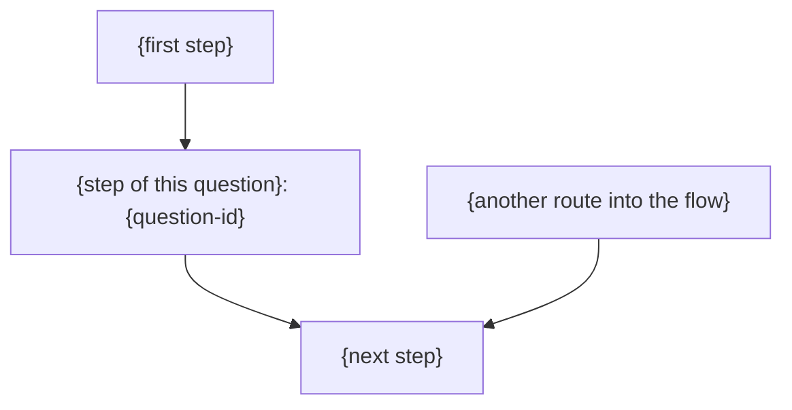

# Question explanation template

Render one question at a time. The instruction owns the fixed batch start and
percentage; the scanner supplies question identities and decision evidence.
Replace placeholders, and omit an analogy only when it would not clarify.

## Where this question sits

Open every explanation with this table, filled from the continuation note, so
the user sees what is being decided before the question itself. Write
`not resolved` for a value the context step could not establish; never guess.

| Context | Value |
| --- | --- |
| Umbrella | {`<umbrella-slug>`, item {x}/{N}: {key title} ({completed}/{N} items completed), umbrella draft `<path>`; or `none, standalone topic`} |
| Topic | {version and slug, as the `topic` line of `pw progress`} |
| Phase | {phase and position, such as `requirement (2/5)`} |
| Draft | {path of the topic's own draft} |
| Document | {path of the document holding these questions, and its type} |
| Questions | {question {k} of {B} in this batch, {first-id} to {last-id}; {U} of {Q} questions in the document still undecided} |
| Review | {live exchange, round and gate, or no live exchange} |

## Progress and status of the question

### {question-id}/{last-question-id} {percentage}% — {question title}

Status: awaiting your decision. Progress indicates position in this batch.

## The bigger picture around this question

Render this section before every question, from the continuation note's
big-picture section, as the instruction's "Compose the big picture shown
before every question" describes. Only the marked step, the labelled diagram
node and the close-up change from one question to the next. Use plain
language, and define each tool-specific term where it first appears.

{For an umbrella item: the umbrella's goal, its items with the completed ones,
and what this item adds to it. Omit this paragraph for a standalone topic.}

The purpose of this {feature or fix} is to **{what the project is for}**. We
are reviewing the {document type} for it, `{version} {slug}`.
{Implementation state, such as "Implementation has not started."}

{Today and after: what exists now, and what the project changes.}

| {Part} | {What it does} |
| --- | --- |
| {part} | {behavior} |

### How {who} will use {the result}

{An ordinary concrete case, such as "Consider an ordinary project with its own
source, tests and virtual environment."}

1. **{First step}** {What happens, and who or what does it.}
2. **{Step of this question}** {What happens.} This is the part involved in **{question-id}**.
3. **{Next step}** {What happens.}

### {Close-up title for each part next to the marked step}

{What it computes or checks, and the earlier decisions that constrain it,
cited by ID and choice, such as `Q01=A3`.}

## The question in that picture

### What {question-id} is asking

{At the marked step, the concrete behavior being decided and why it matters.
Separate the behavior already required from what this question still chooses.}

### Notions you asked about, in more detail

{For each notion in the continuation note's notions section that this question
involves: explain it again in more detail than last time, how it applies to
this question, and where the documents now introduce it. Omit this part when
the question involves none.}

### Example

{A realistic scenario showing the consequences of the choice.}

### BBQ explanation

{A short analogy. Close with an explicit mapping from each analogy element
to the real concept; do not make the user infer the correspondence.}

| Option | Resulting behavior | Advantages | Drawbacks |
| --- | --- | --- | --- |
| A | {behavior} | {pros} | {cons} |
| B | {behavior} | {pros} | {cons} |

### Recommendation: {option}

{Reasoning, assumptions, and relevant earlier decisions.}

### Effects on other questions

{Affected decisions, conditional questions, and possible follow-up issues.}

### Where the choice lands

{The plan or rollout step that carries the choice, such as step 4 of 7, with
the steps before and after it.}

{question-id} remains open: no choice has been recorded.

## Decision prompt

Do not write this section as text. End the turn with the host's blocking
choice, following the instruction's "Ask for the decision as a choice" section
and `rules/interactive_menu.md`. Without one, as in Codex Default mode, end
with the numbered chat list after reporting the question as `blocked` to the
terminal.

- Question text: `{question-id}/{last-question-id} {percentage}%: {question title}`,
  then the decision asked, so it stands alone.
- Entries: the question's options, the recommended one first with
  `(Recommended)`; an explain-more entry when the host has room; amendments
  through the host's free-text entry.

Never pre-record the recommended option as a confirmed user choice.
