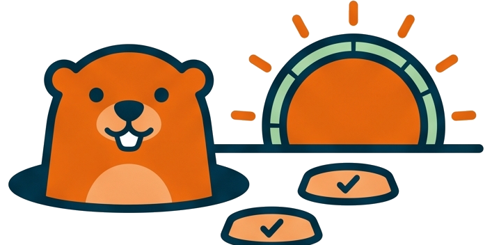

# Groundhog as a reset loop

<!-- markdownlint-disable MD013 -->

## Invocation model

During implementation, the AI normally owns this loop: it calls a scoped `ghog day`,
uses the exit contract to fix failures, coverage gaps, or duration outliers,
and walks again. Run `ghog` directly to learn the gate, reproduce it locally,
or diagnose a specific station without starting an AI workflow.

🧪 Groundhog repeats compile checks and affected tests until the selected
objective is met. Full-suite work is explicit: `pass` proves passing tests,
`cov` adds coverage, and `speed` adds durations. A plain day defaults to the
development walk without a full step, while release preparation requires
whole-suite coverage and implementation commit validation requires speed in
the effort's scope. The walk reports a verdict; its caller applies fixes.

## ⚖️ Why walk and fix are separate

`ghog day` walks, gates and reports; fixing belongs to the caller, human
or LLM, following `instructions/groundhog.md`. That split makes the loop
auditable: every iteration is one walk with one verdict, the fix applied
between two walks is visible in the diff, and the loop has a stopping
rule — no progress, or ten iterations — instead of a model quietly
thrashing.

The walk is also the only re-entry point. After a fix, the next command
is `ghog day` with the same level and scope, never a standalone subcommand as confirmation: the
cheaper inner verifiers (`ghog single`, `ghog affected`) exist inside a
branch, and each branch hands back to the walk.

## Why proof has a level and a scope

A saved green result is useful only for the objective it proved. A passing
suite does not establish coverage, and a group's coverage does not establish
whole-suite coverage. Separate scope markers and ordered proof levels let a
walk reuse a valid lower result while running the stronger requested gate.
Proof at or above the request makes the whole walk free, including check.

Python or gate-configuration changes invalidate source proof. Scope patterns
and membership must also match. Duration-floor or exclusion changes retain
coverage proof but require timing validation again. This makes accepted slow
tests part of the proof contract rather than an invisible workaround.

## ♻️ Why sequential full runs reset testmon

Sequential `ghog full` deletes `.testmondata` and rebuilds it on a single worker.
The fresh database is what makes every later `ghog affected` cheap and
truthful — stale test-impact data would let a change slip through the
fast pass. A grouped full run keeps the database and refreshes only its own
tests' records: a reset would make the next run outside the group treat every
other test as new and execute it. Parallel full runs leave the database
untouched.

## Why coverage and timing share one full run

At speed, both sequential and parallel modes collect coverage and call
durations in the same full run. The walk never repeats the suite solely to
measure timing: one execution supplies the passing-test, coverage, and speed
verdicts. This keeps the cost of the speed gate close to the coverage run.

These durations include coverage overhead and, with parallel workers,
contention. They describe the validation workload the project actually runs.
An optional `ghog timings` diagnostic measures calls sequentially without
coverage, so its results can differ. It is not a required stage of the walk.
Saved speed proof from the former separate timing pass is capped at coverage
until a full run proves speed with the current measurement method.

## 👥 One output, two audiences

The output is mastered for a token budget and a terminal at once. A human
gets a live progress bar; a captured run gets one plain line per 10% and
a 60-second silence floor. LLM-driven runs are redirected to `a.ghog.log`
so the model reads only the tail — last 5 lines on green, last 100 on a
stop — while the user follows the same file live from a second console.
The guard even rewrites a forgotten redirect: a harness capture receives
an envelope naming the log, never the full report.

## 🚦 Why exit codes, not prose

The model branches on `exit=N`, not on wording: 2 failures, 3 coverage,
8 outlier, 6 live, 7 lost. Prose can drift; the contract cannot. The
lifecycle file `a.ghog.status` extends the contract across processes — a
walk killed by a harness timeout is detectable (`ghog status` probes the
pid), and a second walk refuses to start while one is alive, protecting
both the log and the testmon state.

## 🐢 Why slow tests stop a green run

At the speed gate, exit 8 flags a duration outlier even when everything passes, judged last
so it never masks a failure. A suite that creeps past one second per test
stops being run willingly; the gate keeps the feedback loop fast enough
that running it stays the default.

The rule deliberately separates slower from outlier: a call two or three
times the median is merely slower, and flagging it would turn the gate
into noise. A call is stopped only when a robust statistic (the modified
z-score, immune to the outlier inflating a plain average) says it sits
far outside this run's norm, AND it crosses an absolute floor in seconds
— relative oddity alone never flags a uniformly fast suite, and absolute
slowness alone never flags a uniformly slow one the project has accepted.
The floor is the project's one knob, and `ghog exclude` records the
deliberate exceptions at their measured time, each held to that baseline
afterwards.

## 👉 Where the contract is written

- [Fix a red groundhog walk](../how-to/fix-a-red-groundhog-walk.md) for
  the per-branch recipes.
- [ghog commands and exit codes](../reference/ghog-commands-and-exit-codes.md)
  for the full tables.
