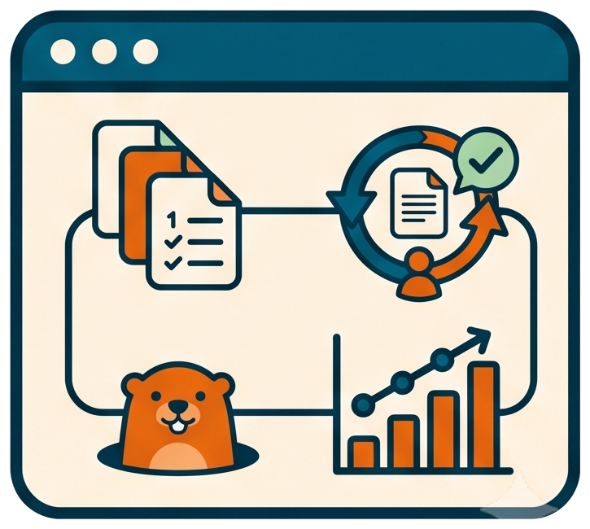

# One body, many agents

<!-- markdownlint-disable MD013 -->

## Invocation model

A human performs the one-time host registration. Afterwards the user asks for
a named skill and the host AI executes the shared body and its internal tools.
Handing an instruction body to an unsupported LLM is the direct fallback.

🤖 The same skill runs from GitHub Copilot, Claude Code, ChatGPT Codex
and Google Antigravity because the skill is not written four times. Each
host gets a thin pointer; the body lives once under `instructions/`.

## What makes a skill

In llm-shared, a skill is a reusable task composed of **instructions plus the
templates, supporting files, and tools those instructions require**. A host's
`SKILL.md` is its entry point, not the whole implementation.

| Shared component | Responsibility |
| --- | --- |
| `instructions/` | Defines the task, inputs, sequence, checks, and stopping conditions; `instructions/prompts/` holds one-shot bodies |
| `rules/` | Defines common behavior such as shell execution, artifact placement, and human decisions |
| `templates/` | Defines the shape of generated documents, handoffs, receipts, or responses |
| Supporting files and `scripts/`, `bin/`, `tools/` | Supply resources and executable operations when the instruction needs them |

Not every skill needs every component. For example, `pause-session` combines
its instruction, artifact rules, a prompt template, and existing artifact-home
tooling. `resume-session` uses a separate instruction and receipt template.
`status-session` needs only an instruction, a response template and read-only
inspection of those artifacts and existing notes. These skills introduce no
standalone shell commands. The generated checkpoint belongs to the consuming
project; the reusable instructions and templates stay shared.

## What scaffolding means here

Scaffolding is the small host-specific layer that makes a shared skill
discoverable and loadable: folders with the host's expected names, metadata
such as a skill name and description, a redirect, and any registration or
plugin manifest the host requires. Each Markdown redirect is an **adapter**.
The host discovers the adapter, follows its direct link to the canonical
instruction, and reads the templates and tools that instruction calls for.

The adapter body contains only that redirect. Keeping a summary or copied
workflow there would create another version to maintain. A new LLM therefore
needs an entry point and access to the shared files, rather than rewritten
instructions for each task. This boundary is defined in the
[adapter rule](../../rules/llm-specific-adapters.md).

Compatibility depends on the **host application and its tools**, not only on
the model name. Codex supplies a different integration surface from plain
ChatGPT, as Antigravity does from plain Gemini chat. A chat that accepts pasted
text can discuss the instructions; performing local work also needs access to
the project and the tools the skill uses. A Markdown adapter cannot supply a
missing filesystem, shell, approval UI, or background-job capability.

Grok currently has portable file redirects. Their presence does not establish
native Grok discovery or slash-command support. The
[compatibility reference](../reference/repository-layout.md#llm-compatibility)
distinguishes shipped integrations from explicit file loading; the
[adapter guide](../how-to/add-an-llm-adapter.md) covers adding another host.

## 🔗 The pointer pattern

`.github/skills/<skill>/SKILL.md` and `.claude/skills/<skill>/SKILL.md`
are frontmatter plus a reference to the same `instructions/<skill>.md`.
Codex is reached two ways: `AGENTS.md` sections and user-level prompts
(`ghog init` writes them for groundhog), or the whole set at once through
the self-contained plugin package under `.agents/llm-shared/`
([the how-to](../how-to/register-skills-as-a-codex-plugin.md)).
Antigravity gets one workflow wrapper per skill under
`.agent/workflows/`, junctioned into the project
([the how-to](../how-to/use-the-skills-from-antigravity.md)). Grok gets
portable command redirects under `.grok/commands/`; explicit file loading
works without assuming native discovery. Another agent can be handed the
canonical body as context. Command names usually match their body filenames;
`fix-slow-test` points to `fix_slow_test.md`, and `prepare_release_notes` is a
compatibility alias.

The same rule covers one-shot prompts and humanizer: their bodies live under
`instructions/prompts/`, with metadata and direct references in the provider
folders. A new host gets adapters to existing content rather than its own
copy of the workflow.

The usual setup keeps one clone beside the projects that use it. A workspace
folder, `--add-dir`, symlink, or plugin junction references that shared clone,
so one `git pull` updates the source for every integration pointing to it.
Hosts with a cached plugin copy may require a refresh before using an edit.

## 🚪 The session references it, the project never does

The consequence is worth insisting on: nothing in your project ever
declares llm-shared. What references it is the **session** you open on
the project, through one of two mechanisms:

- **another root folder in your workspace** — the multi-root workspace
  holds your project root first and the llm-shared root second; that
  alone is enough for GitHub Copilot to discover the skills, prompts and
  agents and offer them to your project,
- **an additional directory on the session** — `/add-dir ..\llm-shared`
  in a running Claude Code session (or `claude --add-dir=../llm-shared`
  at launch), and the same `--add-dir` flag when launching Codex (see
  [openai/codex#2797](https://github.com/openai/codex/issues/2797#issuecomment-4555303886));
  the [Codex plugin route](../how-to/register-skills-as-a-codex-plugin.md)
  makes that reference permanent instead of per-session.

Close the session and your project is exactly as before: no config file
gained a path, no dependency was added, nothing to commit. The pairing
lives in how you open the tools, not in the repository — which is also
why two colleagues can point the same project at different llm-shared
checkouts without stepping on each other.

The benefit is not just less duplication: it is that a fix to a skill
lands everywhere at once, and that the behavior is testable as text — the
body either says it or it does not, whatever the host.

## 🧩 Host differences, isolated at the edges

What actually differs between hosts is kept out of the bodies:

- the complete command token is decided at print time: Claude uses
  `/write-design`, while the installed Codex plugin uses
  `$llm-shared:write-design`; `pw skill` and
  `rules/command_prefix_char.md` keep that host detail at the edge,
- menus go through `rules/interactive_menu.md`, which picks the host's
  native choice mechanism and never assumes a TTY,
- shell mechanics go through `rules/run_commands.md`, and the `bin\*.bat`
  launchers self-locate so no host needs an environment first,
- filesystem, shell, and job-handling limits remain properties of the host;
  an adapter does not change its permissions or supply missing tools.

## 📜 Why MIT fits this model

The repository exists to be copied into other projects — symlinked
skills, vendored folders, single body files handed as context. MIT puts
no condition on that beyond keeping the copyright notice, and it removes
a question copyleft would raise: whether the documents the skills
generate inside someone else's repository inherit the license. It also
matches code already in the tree (`tools\batcolors` ships MIT with the
same holder). The `senv_dev_workflow` build tooling stays under its own
terms — MIT covers llm-shared only.

## 🧱 The boundary with senv_dev_workflow

llm-shared owns the workflow: skills, rules, templates, launchers, the
release-notes side. The build side — `update-changelog.bat`,
`update-version.bat`, `t_build.bat` behind `brel` — comes from the
vendored `senv_dev_workflow` under `tools\dev_workflow\`. The two meet at
exactly one file: `version.txt`, which the notes skill writes and the
release build reads.

## 👉 Where the pieces are listed

- [Repository layout](../reference/repository-layout.md) for who reads
  which folder.
- [Plug llm-shared into your project](../tutorials/01-plug-llm-shared-into-your-project.md)
  for host registration and explicit file loading.
