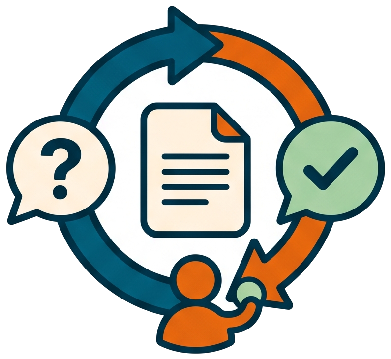

# Where the human stays in the loop

<!-- markdownlint-disable MD013 -->

## Invocation model

The user starts the high-level skill and owns the documented decisions. The AI
owns intermediate skills, launchers, checks, and evidence gathering; a human is
not expected to run those prerequisites merely to keep automation moving.

🔁 The workflow automates every transition it safely can, and keeps a
short, deliberate list of stops where a human decides. Knowing the list
is knowing the workflow: everything between two stops runs by itself.

## 📏 The design rule behind the stops

A stop earns its place when the decision is irreversible, or when only
the author knows the answer. Everything else — writing a document,
running a review, checking an implementation, drafting commit messages —
is reversible text on disk, so the chain runs it without asking.

## ✋ The stops of the document phase

- **The five menus of /process-draft** — title, slug, version, documentation
  layout, and branch layout. Naming and versioning shape everything downstream;
  the documentation-layout choice decides where every document for the effort
  will live. A direct effort or focused child also gets a test-scope choice;
  a collection defers that choice to its children.
- **The umbrella-child approval** — a child derived from one pending umbrella
  row is an interpretation of that row's boundary. The author may revise the
  focused draft repeatedly, and only an explicit `Go ahead` releases it to
  requirement writing. Direct drafts do not add this stop.
- **The review table** — the recurring `[STOP]` of the write, review,
  consolidate loop: the model asks, the human answers the
  `Q0x | Title | Recommended Answer` table. The chain resumes on the
  consolidation, not on a "go ahead".

Requesting consolidation authorizes its question-snapshot commit and, once the
document settles, its grouped cleanup commits before the next phase. Those
commits belong to the chosen consolidation action; the agent does not add a
second approval menu for them.

## 🚪 The optional stop between documents and code

The settled plan is the border between text and code, and crossing it is
a default, not an inevitability. When the last consolidation settles the
plan, the chain starts the implementation of the plan's first step by
itself. A plan writer, on the other hand, calls `pw skill --after-write plan`,
which always starts plan review even if the plan text already contains a
settled-looking marker. After review, bare routing can trust consolidated
decisions (`| Qxx` rows or the "No open questions" row) and advance.

The author who wants to read the settled plan before any code moves says so:
`stop here` in the consolidation invocation, or any explicit instruction
not to implement, turns the handoff into a printed next step and a stop.

## 🛑 The stop of the implement chain

The chain — implement, check, fill gaps, group commits — runs with no
menu until `a.commit` is written. Writing the messages is automatic;
**making the commits is not**. The commit gate presents the grouped plan
and waits for `go ahead` (or the contextual
`go ahead, and implement step <next>`). Every concrete choice still
commits first — a follow-up never skips the gate.

## ⏸️ The pauses of the release preparation

`/prepare-release` pauses wherever the repository's history is about to
change shape: the dirty-tree decision, the rebase-or-merge choice when
the branch is behind `main`, each rebase conflict, the merge message
review, the title pick, the notes review — and it never tags and never
pushes. `brel`, the tag, is always typed by the author.

## Independent review decisions remain human

Opt-in independent review adds a second agent's assessment. The human or an
external service starts the requestor and reviewer separately; neither role
may launch or contact the other. Intermediate rounds continue automatically,
while convergence and marked recovery decisions return to the human. This
preserves the distinction between a review result and authorization to act on
it. See [independent review authority](independent-review-mode-and-human-authority.md).

## Session pauses preserve the decision boundaries

A deliberate session pause can happen in any phase, including while a human
answer is pending. `pause-session` preserves the objective, accepted decisions,
specific permissions, unresolved questions, evidence, live jobs, and next action
in a private prompt. It stops task work without implying that an active job has
finished.

`resume-session` restores that context and checks it against the current
checkout, journals, and running jobs. This matters because a handoff can still
name an action that a later journal entry records as completed. Current evidence
determines what remains to be done.

The usage receipt records successful context recovery. It is neither task
completion nor approval of a pending choice. `--force` allows rereading the
same checkpoint; it leaves approval boundaries and review ownership checks
intact. Already-granted, still-applicable permissions survive the pause, and
new user direction takes precedence over the saved prompt.

## 👉 Where each gate is described

- [From draft to settled requirement](../tutorials/02-from-draft-to-settled-requirement.md)
  for the umbrella-child approval in context.
- [Split a mixed draft](../how-to/split-a-mixed-draft.md) for the collection
  procedure that leads to that approval.
- [Answer a review round](../how-to/answer-a-review-round.md) for the
  review stop.
- [Group a dirty tree into conventional commits](../how-to/group-commits-into-conventional-messages.md)
  for the commit gate.
- [Prepare a release from any branch](../how-to/prepare-a-release.md) for
  the full pause table.
- [Pause and resume a working session](../how-to/pause-and-resume-a-session.md)
  for saving context and returning without losing pending decisions.
