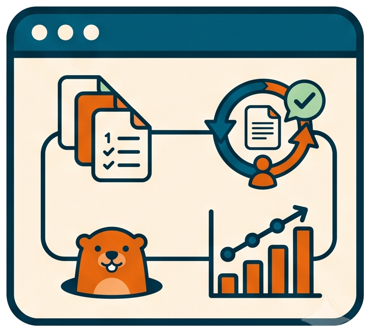

# How to link the skills into ChatGPT Codex



<!-- markdownlint-disable MD013 -->

## Invocation model

The user skills folder link and the removal of the former plugin are
human-owned host configuration. An AI can run the read-only `llmup` check and
report what it found, but the user creates the link, removes the plugin, and
starts the new Codex thread that lists the skills.

🤖 Goal: make every llm-shared skill available in every new ChatGPT Codex
thread as `$llm-shared:<skill>`, read in place from the clone: no copy, no
plugin install, and no command to run after a `git pull` or an edit.

## 📦 What the repository already ships

The skill package lives under `.agents/llm-shared/` in the clone:

```txt
.agents/llm-shared/
├─ .codex-plugin/plugin.json     manifest; its "name" gives the llm-shared: prefix, its version stays fixed
├─ skills/<skill>/SKILL.md       one wrapper per root instruction, UTF-8 without BOM, name + description frontmatter
├─ instructions/                 compatibility redirects to root instructions/
└─ rules/                        compatibility redirect to root rules/docs_layout.md
```

Codex reads user skills from `.agents\skills` in your home folder,
`%USERPROFILE%\.agents\skills`, and follows a linked folder to its target. One
junction from that folder to the package `skills\` folder is the whole
registration. Codex then shows each skill at its resolved clone path and names
it `llm-shared:<skill>` after the package manifest.

The package sits one level below `.agents/` on purpose: a package directly in
the clone's `.agents/skills` would also be picked up as project skills when
Codex runs inside the clone, and every skill would appear twice.

## 🧩 Keep every instruction at the repository root

For every root `instructions\<name>.md`, the package contains:

- `skills\<hyphenated-name>\SKILL.md`, with valid `name` and `description`
  frontmatter and a direct redirect to the root instruction,
- `instructions\<name>.md`, as a compatibility redirect to the root
  instruction.

Never copy the instruction body into the package. Follow
[`llm-specific-adapters.md`](../../rules/llm-specific-adapters.md) whenever a
wrapper or compatibility path is added or changed.

Every redirect links relative to its own file in the clone: a wrapper climbs
four levels, `../../../../instructions/<name>.md`, and a compatibility redirect
three, `../../../instructions/<name>.md`. Codex reads the wrappers at their
resolved clone path, so these links resolve wherever the clone lives: it no
longer has to sit at `%USERPROFILE%\git\llm-shared`.

The structural regression tests check the complete one-to-one contract and
that every link resolves:

```cmd
ghog single tests\unit\tools\test_instruction_structure\test_codex_plugin_structure_tdd.py
```

## 📋 Link the skills on a machine

1. Initialize an interactive `cmd` with the clone's `senv.bat`, then check the
   current state:

   ```cmd
   llmup
   ```

   It validates the package and, on a machine without the link, reports
   `%USERPROFILE%\.agents\skills` as absent with exit code `2`.

2. Create the link:

   ```cmd
   llmup --create
   ```

   On Windows this makes a junction, which needs no administrator rights.
   Without the alias, run the launcher by full path,
   `"<clone>\bin\codex_skills_link.bat" --create`, or create the same junction
   by hand:

   ```cmd
   mklink /J "%USERPROFILE%\.agents\skills" "<clone>\.agents\llm-shared\skills"
   ```

   Link the whole folder. With a link one level down, such as
   `%USERPROFILE%\.agents\skills\llm-shared`, Codex shows the link path
   instead of the clone path, and every wrapper link breaks.

3. Start a new Codex thread.

`llmup` refuses, and changes nothing, when `%USERPROFILE%\.agents\skills`
already holds other content or links to another folder: move that content or
remove that link yourself first. Its options and exit codes are in the
[aliases reference](../reference/aliases-and-launchers.md#codex-skills-link).

## 🔁 Migrate from the plugin install

A machine wired by the former plugin route has the `llm-shared@personal`
plugin installed. Kept next to the link, it lists every skill twice: `llmup`
warns about it and prints the removal command.

1. Remove the plugin and its cached copy:

   ```cmd
   codex plugin remove llm-shared@personal
   ```

2. Optionally, remove what only the plugin needed: the `llm-shared` entry of
   `%USERPROFILE%\.agents\plugins\marketplace.json` (or the whole marketplace,
   with `codex plugin marketplace remove personal`, when it lists nothing
   else), and the `%USERPROFILE%\plugins\llm-shared` junction (`rmdir` removes
   the junction only, never the clone).
3. Create the link with `llmup --create`, as above.
4. Start a new Codex thread.

## 🔄 Pick up additions and instruction changes

Nothing to run. Codex reads the wrappers and the instructions from the clone
itself, so a `git pull`, a new skill, or an edited instruction reaches the next
new thread. Codex detects skill changes on its own; if one does not appear,
restart Codex. A resumed thread keeps the skill list it started with.

`llmup` never writes inside the clone: the package version stays fixed, and no
cachebuster or reinstall is involved any more.

## ✅ Check the registration took

Outside any session, render the model-visible prompt:

```cmd
codex debug prompt-input
```

It must list the prefixed skills (`llm-shared:process-draft`,
`llm-shared:group-commits-msg`, ...) with their files under the clone's
`.agents/llm-shared/skills` folder, and no skipped-skill or missing-frontmatter
warning. Inside a fresh session, `$llm-` completes to the same names, and
asking "list your available skills from llm-shared" returns one entry per root
instruction, including `llm-shared:install-sensitive-git-hooks`,
`llm-shared:sanitize-git-history`, and `llm-shared:isolate-logos`.

## 🪙 What the metadata costs per session

The upfront price is the registry only (names, descriptions and source paths),
in the order of 1.3k to 1.8k tokens per session. The `SKILL.md` bodies and the
instruction files are read only when a skill actually runs.

## ⚠️ Pitfalls this recipe already avoids

- **A link one level down**: `%USERPROFILE%\.agents\skills\llm-shared` keeps
  the link path as the skill root, so the clone-relative wrapper links no
  longer resolve; link the whole `skills` folder.
- **The plugin and the link together**: an installed `llm-shared@personal`
  plugin next to the link lists every skill twice; remove the plugin.
- **A UTF-8 BOM in SKILL.md**: Codex then misses the `---` at byte 0 and
  reports missing frontmatter; the shipped wrappers are BOM-less, keep them
  that way when editing on Windows.
- **Underscores or extra frontmatter keys**: Codex skill names refuse `_` (the
  wrapper for `fix_slow_test.md` is named `fix-slow-test`), and the `llmup`
  validator rejects keys beyond `name`, `description`, a `metadata` mapping and
  the `llm_nature: codex` adapter hint.
- **Copied wrappers**: a copy in `%USERPROFILE%\.agents\skills` or
  `%USERPROFILE%\.codex\skills` goes stale and misses every new skill; keep the
  link.
- **A wrapper link written for another location**: a link relative to an
  install folder or to a fixed clone path breaks in the clone; write it
  relative to the file in the clone.
- **Expecting a resumed thread to refresh**: open a new thread to see a new
  skill.

## 🧪 The lighter route for groundhog only

`ghog init` needs none of this: it writes the project `AGENTS.md`
section and the `~/.codex/prompts/groundhog.md` custom prompt, which is
enough to trigger the fixing loop from Codex; see
[Register groundhog in a project](register-groundhog-in-a-project.md).
The link route is for the whole skill set.

Related: [Plug llm-shared into your project](../tutorials/01-plug-llm-shared-into-your-project.md),
[Pick up skill edits without restarting](pick-up-skill-edits-without-restarting.md),
[One body, many agents](../explanation/one-body-many-agents.md).
